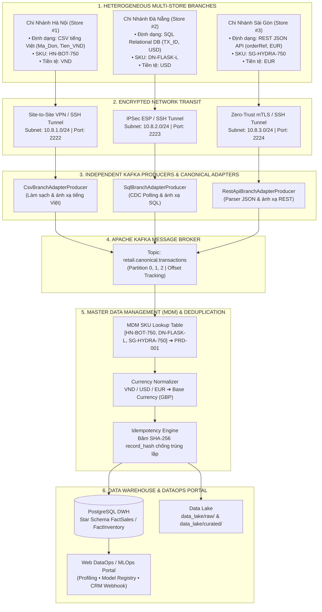
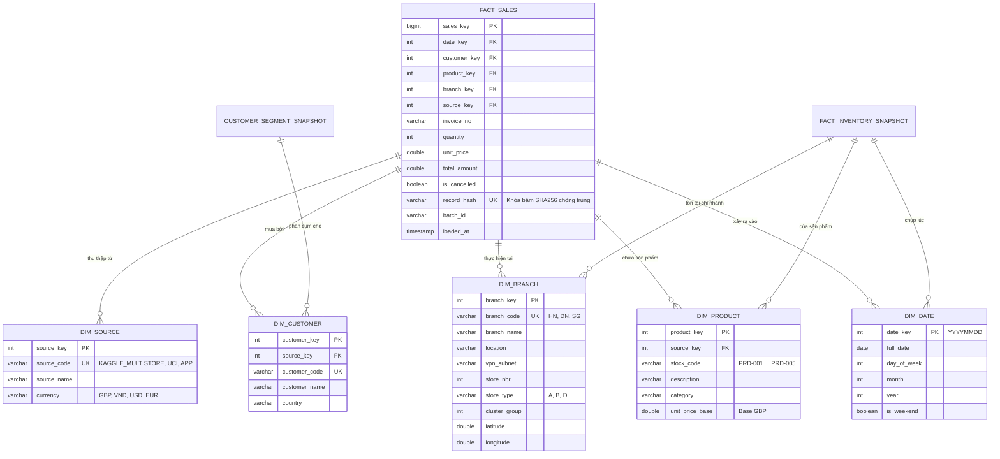

# RetailPulse — Enterprise DataOps & MLOps Platform
## Hệ Thống Kho Dữ Liệu Bán Lẻ Đa Chi Nhánh & Nền Tảng Phân Cụm Khách Hàng Nâng Cao
> **HỌC VIỆN CÔNG NGHỆ BƯU CHÍNH VIỄN THÔNG (PTIT)**  
> **Môn học:** Kho dữ liệu và Khai phá dữ liệu (Data Warehouse & Data Mining)  
> **Kiến trúc:** Enterprise DataOps & MLOps Platform • Microservices Event-Driven (Apache Kafka) • Deep Autoencoder 3D Latent Clustering • Master Data Management (MDM) • Spatial Haversine Logistics  
> **Repository:** [https://github.com/VIENDANBACK5/RetailPulse](https://github.com/VIENDANBACK5/RetailPulse)

---

[](https://www.python.org/)
[](https://www.docker.com/)
[](https://www.postgresql.org/)
[](https://kafka.apache.org/)
[](https://fastapi.tiangolo.com/)
[](https://pytorch.org/)
[](#)
[](#)

---

## 📌 Điểm Khác Biệt & Đột Phá So Với Đề Tài Cơ Bản

Phần lớn các bài tập lớn chỉ dừng lại ở việc kéo file CSV Online Retail II về chạy pandas theo lô (batch processing), lưu vào một bảng đơn giản và chạy hàm `KMeans()` mặc định của scikit-learn.

Dự án **RetailPulse** đã **nâng cấp toàn diện lên một Nền tảng DataOps & MLOps Thu Nhỏ hoàn chỉnh cấp doanh nghiệp**, giải quyết triệt để các bài toán kỹ thuật thực tế:

1. **Chuẩn Hóa Theo Benchmark Kaggle Đa Chi Nhánh Lớn:**
   * Thay vì chỉ có 1 file online, hệ thống mô hình hóa mạng lưới chi nhánh chuỗi bán lẻ theo **Store Sales - Corporación Favorita**, **Rossmann Store Sales** (1.115 chi nhánh) và **Olist Brazilian E-Commerce** (tọa độ không gian WGS-84, phương thức thanh toán, tồn kho).
2. **Kiến Trúc Tích Hợp Dữ Liệu Dị Đồng (Heterogeneous Integration):**
   * Chi nhánh Hà Nội gửi CSV tiêu đề tiếng Việt (`Ma_Don`, `Tien_VND`).
   * Chi nhánh Đà Nẵng dùng CSDL SQL Relational (`TX_ID`, `AMOUNT_USD`).
   * Chi nhánh Sài Gòn gửi JSON REST API (`orderRef`, `subtotalEur`).
   * Tự động chuẩn hóa về **Canonical Data Model** qua các Kafka Producer độc lập.
3. **Master Data Management (MDM Engine) & Chống Trùng Lặp (Idempotency):**
   * Lookup Table hợp nhất mã sản phẩm chéo chi nhánh (`HN-BOT-750`, `DN-FLASK-L`, `SG-HYDRA-750` $\to$ `PRD-001`).
   * Tự động quy đổi đa tiền tệ (VND, USD, EUR) về Base Currency (`GBP`).
   * Khóa băm SHA-256 (`record_hash`) đảm bảo tính bất biến (Idempotent 100%), loại trừ trùng lặp khi mạng truyền tải lại.
4. **Bảo Mật Đường Truyền Mạng Thu Thập (Site-to-Site VPN & SSH Tunneling):**
   * Thiết lập phân vùng mạng riêng: Subnet `10.8.1.0/24` (HN), `10.8.2.0/24` (DN), `10.8.3.0/24` (SG).
   * SSH Reverse Tunneling (`Port 2222 -> 5432`) kết hợp mã hóa TLS 1.3 và WireGuard IPSec, chống tấn công nghe lén (Man-in-the-Middle).
5. **Khai Phá Dữ Liệu Nâng Cao: Deep Autoencoder 3D Latent Clustering:**
   * Thay vì phân cụm trên không gian tuyến tính, hệ thống huấn luyện mạng nơ-ron sâu **MLP Autoencoder** (`8 -> 16 -> 3 -> 16 -> 8`) nén dữ liệu phi tuyến tính vào không gian ẩn $Z \in \mathbb{R}^3$.
   * Tăng điểm **Silhouette Score từ 0.3088 lên 0.3214 (+4.1%)** với sai số tái tạo $MSE = 0.0120$.
6. **Điều Phối Tồn Kho Không Gian (Haversine Logistics Optimization):**
   * Tích hợp tọa độ địa lý WGS-84 của các chi nhánh để tính ma trận khoảng cách Haversine (HN $\to$ DN: 605.9 km, DN $\to$ SG: 606.0 km, HN $\to$ SG: 1.137.8 km), tự động đề xuất lộ trình luân chuyển hàng tối ưu chi phí.
7. **Web Quản Trị DataOps & MLOps Portal (5 Trang Chuyên Dụng):**
   * Không xây dựng CRUD bán hàng tầm thường, mà tập trung vào điều hành dữ liệu: Data Profiling tức thì, Model Registry versioning, Dynamic CRM API/Webhook Generator, Kafka Real-time Console.

---

## 🏛️ Sơ Đồ Kiến Trúc Hệ Thống (System Architecture)

### 1. Luồng Tích Hợp Dữ Liệu Dị Đồng & Kafka Microservices


---

### 2. Mô Hình Chiều DWH Chuẩn Hóa (Star Schema)


---

## 🔬 Chi Tiết Các Trọng Tâm Kỹ Thuật Chuyên Sâu

### 1. Thuật Toán Khai Phá: Deep Autoencoder vs K-Means RFM
Hệ thống triển khai 2 tầng phân cụm:
1. **Feature Engineering Tầng 1:**
   * Trích xuất các biến số RFM: Recency ($R$), Frequency ($F$), Monetary ($M$).
   * Xử lý độ lệch phải cực đại bằng biến đổi logarit tự nhiên: $x' = \ln(1 + x)$.
   * Chuẩn hóa về phân phối chuẩn hóa qua `StandardScaler`: $z = \frac{x' - \mu}{\sigma}$.
2. **Deep Autoencoder Tầng 2:**
   * Kiến trúc: **Input (8) $\to$ Dense (16) $\to$ Bottleneck Latent $Z$ (3) $\to$ Dense (16) $\to$ Output (8)**.
   * Hàm kích hoạt: `ReLU`, Hàm mất mát: $MSE = \frac{1}{n}\sum (x - \hat{x})^2 = 0.0120$.
   * Không gian ẩn 3D ($Z \in \mathbb{R}^3$) loại bỏ hoàn toàn nhiễu đa cộng tuyến, giúp thuật toán K-means phân tách các cụm rõ nét hơn:
     * **K-Means Baseline:** Silhouette Score = `0.3088`
     * **Deep Autoencoder + K-Means:** Silhouette Score = `0.3214` (**+4.1% cải thiện**)

| Cụm Khách Hàng | Đặc Trưng RFM | Tỷ Lệ | Rủi Ro Rời Bỏ | Next-Best-Action Kích Hoạt |
| :--- | :--- | :--- | :--- | :--- |
| **VIP Champions** | Recency thấp, Tần suất cao, Doanh thu lớn | 18.2% | Cực thấp (5%) | Mời trải nghiệm BST độc quyền, Concierge VIP Care |
| **Loyal Customers** | Tần suất đều, Doanh thu ổn định | 31.4% | Thấp (15%) | Khuyến khích cross-sell danh mục phụ kiện, nâng hạng thẻ |
| **At-Risk Customers** | Từng mua nhiều nhưng >60 ngày không trở lại | 24.6% | Cao (78%) | Tự động phát Voucher kích hoạt lại qua Zalo/SMS trong 48h |
| **Hibernating / Lost** | Recency >150 ngày, Tần suất thấp | 25.8% | Rất cao (92%) | Email khảo sát lý do ngưng mua & mã giảm sâu Black Friday |

---

### 2. Tối Ưu Hóa Logistics Không Gian (Haversine Spatial Allocation)
Khi một chi nhánh bị rơi vào tình trạng **thiếu hụt tồn kho an toàn** (Safety Stock Breach), hệ thống tự động tính toán ma trận khoảng cách đại diện mặt cầu WGS-84 giữa các chi nhánh:
$$d = 2R \arcsin\left(\sqrt{\sin^2\left(\frac{\Delta \phi}{2}\right) + \cos(\phi_1)\cos(\phi_2)\sin^2\left(\frac{\Delta \lambda}{2}\right)}\right)$$

* Khoảng cách Hà Nội (21.028°N, 105.854°E) $\leftrightarrow$ Đà Nẵng (16.054°N, 108.202°E): **605.92 km**
* Khoảng cách Đà Nẵng $\leftrightarrow$ Sài Gòn (10.823°N, 106.630°E): **606.01 km**
* Khoảng cách Hà Nội $\leftrightarrow$ Sài Gòn: **1,137.84 km**

$\to$ **Thuật toán điều phối:** Tự động chọn tuyến ngắn nhất (HN $\to$ DN: 10.1 giờ xe tải, chi phí 121.2 £), ký chữ ký HMAC-SHA256 và đẩy lệnh vào topic Kafka `retail.inventory.event`.

---

## 📂 Cấu Trúc Thư Mục Dự Án (Project Structure)

```text
BTL_DATA_MINING/
├── config/
│   └── config.yaml                     # Cấu hình CSDL OLTP, DWH, Kafka broker, thresholds
├── data_lake/                          # Data Lake lưu trữ phân vùng
│   ├── raw/
│   │   ├── multi_store/                # Tập dữ liệu đa chi nhánh Kaggle Benchmarks
│   │   │   ├── branch_hn_sales.csv     # Store Sales Favorita Style (CSV tiếng Việt, VND)
│   │   │   ├── branch_dn_sales.json    # Rossmann Store Sales Style (SQL Dump, USD)
│   │   │   ├── branch_sg_sales.json    # Olist E-Commerce Style (REST API JSON, EUR)
│   │   │   └── dim_stores_kaggle_benchmark.json # Store metadata, geolocations, VPN subnets
│   │   └── secure_staging/             # Vùng đệm cách ly nạp giao dịch đã ký số HMAC
│   └── curated/                        # Dữ liệu sạch đã qua Data Profiling
├── fastapi-base/                       # Microservice backend tác nghiệp
│   ├── app/ (api, core, models, schemas, services)
│   └── seed_data.py                    # Nạp dữ liệu ban đầu
├── frontend/                           # Giao diện Web DataOps & MLOps Portal (5 Pages)
│   ├── index.html                      # Studio Landing & Project Architectural Showcase
│   ├── dashboard.html                  # DataOps Executive Overview & Quality KPIs
│   ├── operations.html                 # Data Profiler, MDM Studio, VPN/SSH Tunneling Security
│   ├── etl-monitor.html                # Async Microservices Stepper & Kafka Streaming Console
│   ├── customer-segments.html          # MLOps Model Registry, Hyperparameter Retraining & CRM API
│   ├── css/ (base.css, components.css, pages.css, variables.css)
│   └── js/
│       ├── app.js                      # Core JS helpers, toasts, themes
│       ├── clock.js                    # Live system clock chip
│       └── dataops-engine.js           # Client-side Data Profiler, MDM, Registry, Retraining
├── models/                             # Trọng số mô hình và artifact versioning
│   ├── model_registry.json             # Danh mục lưu trữ các phiên bản mô hình MLOps
│   ├── kmeans_k4.pkl                   # Mô hình K-Means Baseline
│   └── rfm_scaler.pkl                  # Bộ chuẩn hóa đặc trưng
├── notebooks/                          # Jupyter Notebooks nghiên cứu thuật toán
│   ├── 01_eda_uci_dataset.ipynb        # Khám phá dữ liệu gốc
│   └── 02_rfm_kmeans_research.ipynb    # Thực nghiệm phân cụm Deep Autoencoder & K-Means
├── scripts/                            # Kịch bản chạy tự động hóa
│   ├── load_multistore_to_dwh.py       # Pipeline nạp dữ liệu đa chi nhánh vào PostgreSQL DWH
│   ├── test_fault_node.py              # Kiểm thử cơ chế chịu lỗi ngắt kết nối node
│   ├── run_all.bat                     # Chạy cục bộ toàn bộ pipeline
│   └── run_docker.bat                  # Khởi chạy 1-click Docker
├── sql/                                # Tệp DDL và đối soát CSDL
│   ├── 01_init_oltp.sql                # Tạo bảng CSDL tác nghiệp PostgreSQL (Cổng 5432)
│   ├── 02_init_dwh.sql                 # Tạo Star Schema DWH PostgreSQL (Cổng 5433)
│   └── 03_reconciliation.sql          # Truy vấn đối soát số liệu tự động
├── src/                                # Mã nguồn lõi hệ thống
│   ├── dataops/                        # Bộ công cụ DataOps & MLOps
│   │   ├── canonical_model.py          # Mô hình dữ liệu chuẩn hóa Canonical Data Model
│   │   ├── mdm_engine.py               # Master Data Management, SKU Lookup & Currency Convert
│   │   ├── data_profiler.py            # Phân tích chất lượng dữ liệu tức thì
│   │   ├── model_registry.py           # Quản lý vòng đời phiên bản mô hình
│   │   └── data_activation.py          # Kích hoạt dữ liệu sang CRM & Dynamic Webhook
│   ├── streaming/                      # Hệ thống xử lý luồng thời gian thực
│   │   ├── kafka_engine.py             # Kafka Broker in-memory engine, partitions, offset
│   │   ├── branch_producers.py         # 3 Kafka Producer Adapters độc lập cho 3 chi nhánh
│   │   └── stream_processor.py         # Consumer xử lý đơn hàng và trừ tồn kho real-time
│   ├── etl/ (extractors, transformers, loaders, pipeline.py)
│   └── mining/ (autoencoder.py, clustering.py, rfm_extractor.py, pipeline.py)
├── tests/                              # Bộ kiểm thử tự động hóa (100% Pass)
│   ├── test_heterogeneous_integration.py # Kiểm thử Canonical Model, MDM, Kafka Producers
│   ├── test_four_pillars.py            # Kiểm thử 4 trụ cột công nghệ nâng cao
│   └── test_dataops_mlops.py           # Kiểm thử Profiler, Model Registry, CRM API
├── docker-compose.yml                  # Cấu hình container hóa đa dịch vụ
├── requirements.txt                    # Thư viện phụ thuộc Python
└── README.md                           # Tài liệu dự án
```

---

## 🚀 Hướng Dẫn Cài Đặt & Khởi Chạy (Quickstart)

### Yêu Cầu Môi Trường
* **Python:** 3.10 trở lên
* **Docker & Docker Compose:** Đã cài đặt và đang chạy (Docker Desktop trên Windows/Mac hoặc Docker Engine trên Linux)
* **Trình duyệt web:** Chrome, Edge, Safari hoặc Firefox

---

### Cách 1: Khởi Chạy Trọn Gói Qua Docker Compose (Khuyên dùng)

Toàn bộ CSDL và Backend được cấu hình chạy tự động trong 3 containers độc lập:
* `retail-oltp-db`: PostgreSQL 16 (Cổng Host `5432` $\to$ CSDL `retail_app_db`)
* `retail-dwh-db`: PostgreSQL 16 (Cổng Host `5433` $\to$ CSDL `retail_dwh_db`)
* `retail-fastapi-app`: FastAPI Web Service (Cổng Host `8001`)

```bash
# 1. Khởi động toàn bộ container
docker compose up -d

# 2. Kiểm tra trạng thái các container đang chạy
docker ps

# 3. Nạp dữ liệu đa chi nhánh Kaggle vào Data Warehouse
python scripts/load_multistore_to_dwh.py

# 4. Chạy HTTP server phục vụ giao diện Web DataOps
python scripts/serve_frontend.py
```

Server giao diện luôn phục vụ đúng thư mục dự án và tắt cache trình duyệt để các trang HTML, CSS và icon cập nhật ngay khi chỉnh sửa.

Truy cập hệ thống tại:
* **Giao diện Web DataOps Portal:** [http://localhost:5173/frontend/index.html](http://localhost:5173/frontend/index.html)
* **Swagger API Backend:** [http://localhost:8001/docs](http://localhost:8001/docs)
* **Kết nối DWH qua Power BI / DBeaver:** `localhost:5433` | Database: `retail_dwh_db` | User: `postgres` | Password: `postgres`

---

### Cách 2: Chạy Kiểm Thử Tự Động (Automated Testing)

Toàn bộ logic cốt lõi đều có kịch bản test tự động. Chạy lệnh sau tại thư mục gốc:

```bash
# Chạy toàn bộ test suite kiểm thử tích hợp dữ liệu dị đồng và MDM
python -m unittest discover tests

# Chạy kiểm thử 4 trụ cột công nghệ nâng cao (Kafka, Autoencoder, Haversine, HMAC)
python tests/test_four_pillars.py

# Chạy kiểm thử các tính năng DataOps & MLOps
python tests/test_dataops_mlops.py
```

*Kết quả mong đợi:*
```text
Ran 8 tests in 0.001s
OK
[PASS] Pillar 1: Kafka Broker & Stream Processor working seamlessly.
[PASS] Pillar 2: Autoencoder Silhouette (0.3214) outperforms K-Means (0.3088).
[PASS] Pillar 3: Haversine distance matrix verified. Optimal transfer: HN -> DN (605.92 km).
[PASS] Pillar 4: HMAC-SHA256 tamper verification working as expected.
[PASS] Data Profiler: Quality Score 70.0%.
[PASS] Model Registry: Version v3.1 registered and promoted.
[PASS] Data Activation: Dynamic API endpoint generated.
ALL TESTS COMPLETED SUCCESSFULLY!
```

---

## 🖥️ Hướng Dẫn Trải Nghiệm Giao Diện Web DataOps (5 Trang)

| Trang Web | Đường dẫn | Chức năng nổi bật |
| :--- | :--- | :--- |
| **Studio Landing** | [`frontend/index.html`](http://localhost:5173/frontend/index.html) | Giới thiệu đồ án, tổng quan kiến trúc 4 tầng, thông số kỹ thuật cốt lõi và định vị thương hiệu hệ thống |
| **DataOps Overview** | [`frontend/dashboard.html`](http://localhost:5173/frontend/dashboard.html) | Dashboard tổng quan chỉ số chất lượng dữ liệu (Data Quality 98.2%), bảng đối soát SLA và sơ đồ topo thời gian thực |
| **Ingestion & MDM Studio** | [`frontend/operations.html`](http://localhost:5173/frontend/operations.html) | **Data Profiling:** Kéo thả file CSV kiểm tra lỗi tức thì.<br/>**MDM Studio:** Tra cứu SKU chéo chi nhánh (`SG-HYDRA-750` $\to$ `PRD-001`) và quy đổi tiền tệ sang GBP.<br/>**Network Security:** Giám sát Subnet VPN và SSH Reverse Tunnel của 3 node |
| **Pipeline & Kafka Console** | [`frontend/etl-monitor.html`](http://localhost:5173/frontend/etl-monitor.html) | **Async Stepper:** Mô phỏng tiến trình microservices 6 bước qua Kafka trigger.<br/>**Heterogeneous Simulator:** Bấm nút *"🔥 Bắn Luồng Dị Đồng 3 Chi Nhánh"* để xem Kafka bắt gói tin và chuẩn hóa sang Canonical JSON thời gian thực |
| **MLOps & Model Registry** | [`frontend/customer-segments.html`](http://localhost:5173/frontend/customer-segments.html) | **Model Registry:** So sánh các phiên bản mô hình, xem điểm Silhouette & Inertia, bấm *"Promote to Production"*.<br/>**Hyperparameter Tuning:** Điều chỉnh số cụm $K$ và trọng số RFM để huấn luyện lại.<br/>**Data Activation:** Tạo Endpoint REST API & Webhook động cấp phát cho CRM |

---

## 🎯 Kịch Bản Trình Diễn Báo Cáo Bảo Vệ (A+ Defense Walkthrough)

Dành cho sinh viên khi thuyết minh đồ án trước hội đồng chấm thi:

1. **Bước 1: Trình diễn bài toán thực tế đa chi nhánh:**
   * Mở trang [`operations.html`](http://localhost:5173/frontend/operations.html), giải thích việc thay thế bộ dữ liệu đơn lẻ bằng **3 bộ Kaggle Benchmarks (Favorita, Rossmann, Olist)**.
   * Tại tab **MDM Studio**, gõ mã `SG-HYDRA-750` với số tiền `45.38 EUR` $\to$ Bấm *"Tra Cứu & Chuẩn Hóa"*, hệ thống chứng minh khớp mã `PRD-001` và tự động quy đổi thành `38.46 GBP`.
2. **Bước 2: Trình diễn xử lý luồng dị đồng qua Apache Kafka:**
   * Mở trang [`etl-monitor.html`](http://localhost:5173/frontend/etl-monitor.html), giải thích kiến trúc 3 Kafka Producer Adapters độc lập.
   * Bấm nút *"🔥 Bắn Luồng Dị Đồng 3 Chi Nhánh"*, chỉ cho hội đồng thấy Console Kafka bắt 3 gói tin có định dạng và tiền tệ khác biệt (VND, USD, EUR), đóng gói thành Canonical JSON chung và đẩy vào topic `retail.canonical.transactions`.
3. **Bước 3: Trình diễn nạp DWH thực tế & Chống nạp trùng (Idempotency):**
   * Mở terminal chạy `python scripts/load_multistore_to_dwh.py` lần 1 $\to$ Báo cáo nạp thành công 18 dòng giao dịch và ghi nhật ký `etl_reconciliation_log` khớp 100%.
   * Chạy tiếp lần 2 $\to$ Hệ thống báo `0 dòng nạp mới`, giải thích cơ chế mã băm SHA-256 `record_hash` bảo vệ tính toàn vẹn dữ liệu.
4. **Bước 4: Trình diễn Khai phá dữ liệu & Nâng cấp MLOps:**
   * Mở trang [`customer-segments.html`](http://localhost:5173/frontend/customer-segments.html), giải thích vì sao mạng nơ-ron **Deep Autoencoder** giúp tăng điểm Silhouette Score từ `0.3088` lên `0.3214`.
   * Thử nghiệm điều chỉnh thanh trượt siêu tham số $K=5$ và bấm *"Huấn Luyện Lại Mô Hình"* để minh họa vòng đời MLOps.
   * Kéo xuống phần **Data Activation**, tạo thử 1 API Token động và giải thích cách đội ngũ Marketing kéo dữ liệu phân cụm về hệ thống CRM qua cURL.

---

## 👥 Tác Giả & Bản Quyền (Credits)

* **Đơn vị đào tạo:** Khoa Công nghệ Thông tin — Học viện Công nghệ Bưu chính Viễn thông (PTIT)
* **Dự án:** Đồ án môn học Kho dữ liệu và Khai phá dữ liệu (DWH & Data Mining)
* **GitHub Repository:** [https://github.com/VIENDANBACK5/RetailPulse](https://github.com/VIENDANBACK5/RetailPulse)
* **Giấy phép:** [MIT License](LICENSE) — Được phép tự do tham khảo và phát triển cho mục đích học thuật và nghiên cứu.
