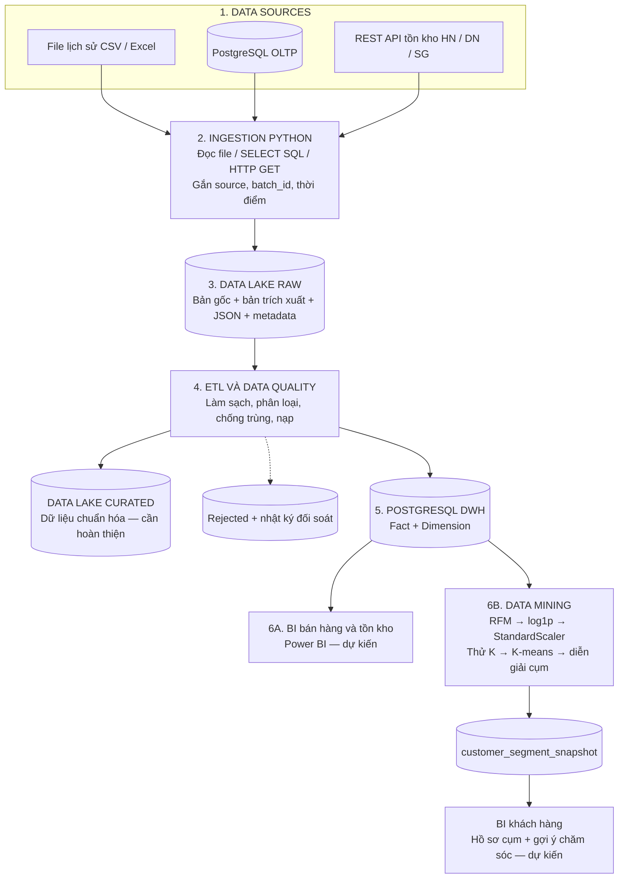
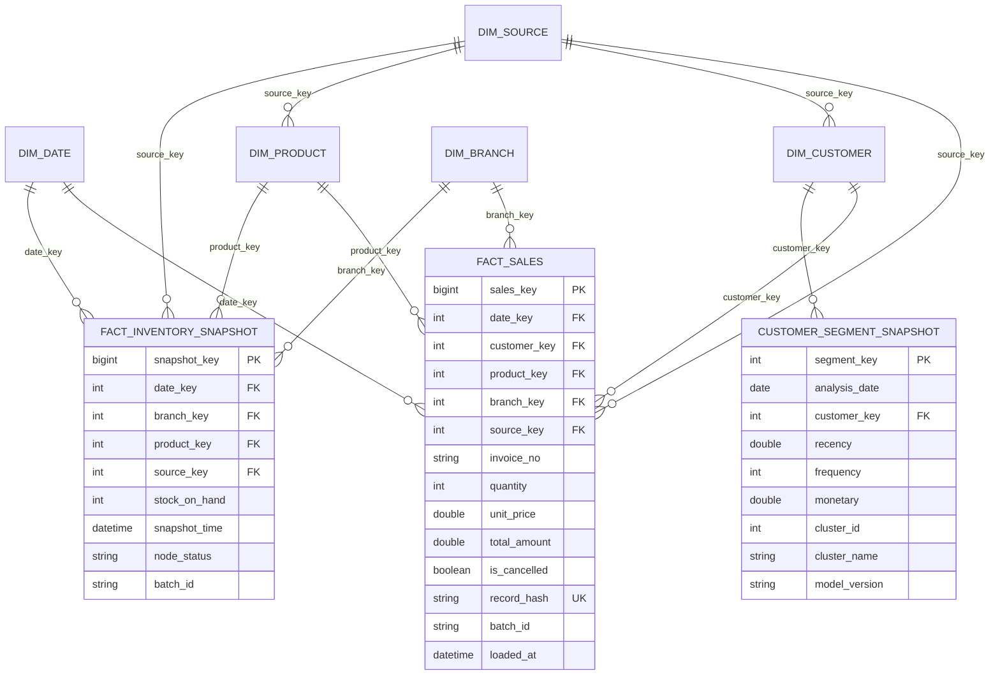
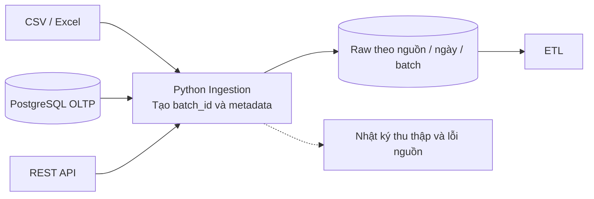
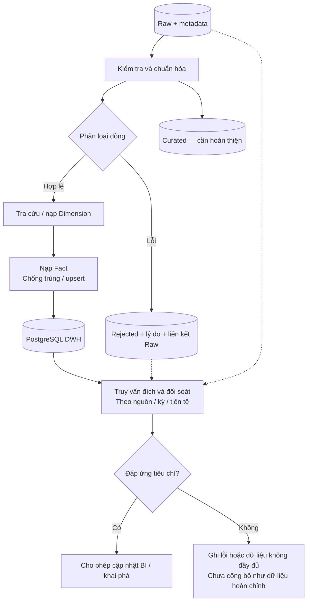
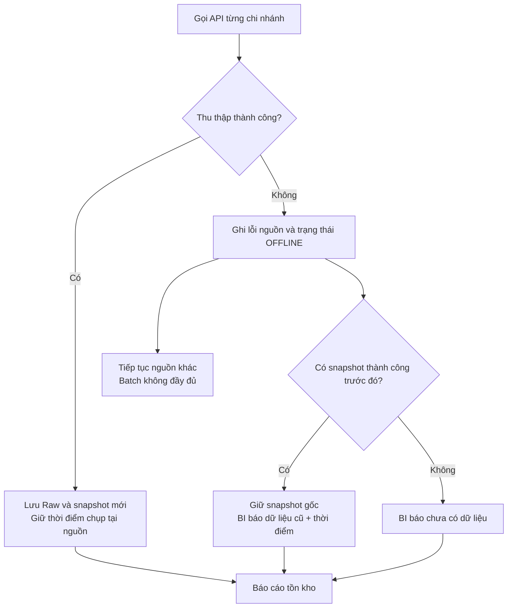
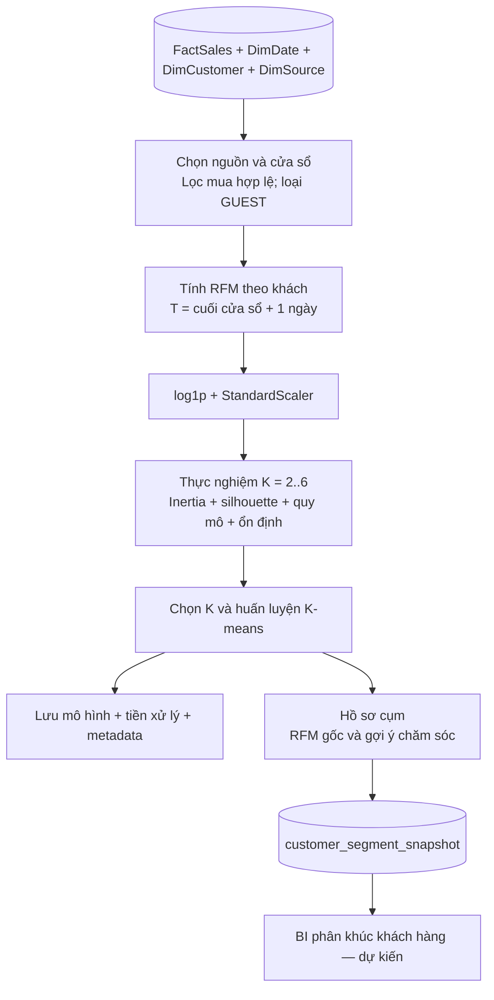

> **C?p nh?t tri?n khai 21/10/2026:** Lu?ng c?t l?i ?? ch?y v? ki?m ch?ng; xem [ki?n tr?c th?c t?](docs/SYSTEM_ARCHITECTURE.md), [HLD v4 editable](docs/architecture/RetailPulse_HLD_v4.drawio), [b?o c?o nghi?m thu](docs/IMPLEMENTATION_REPORT.md). V3 ???c gi? ?? ??i chi?u. Power BI Desktop/report v?n BLOCKED; Semantic Model/DAX ch?a thay th? b?ng ch?ng refresh Desktop.

# ĐẶC TẢ KIẾN TRÚC HỆ THỐNG VÀ LUỒNG DỮ LIỆU ĐỂ VẼ DRAW.IO

**Đề tài:** Xây dựng kho dữ liệu bán hàng và ứng dụng phân cụm khách hàng hỗ trợ chăm sóc khách hàng (RetailPulse).  
**Môn học:** Kho dữ liệu và Khai phá dữ liệu — PTIT.  
**Phương pháp khai phá chính:** RFM và K-means.  


> Tài liệu xác định kiến trúc mục tiêu cho bài tập lớn, các luồng cần trình diễn và hướng dẫn vẽ Draw.io. Trạng thái triển khai được ghi riêng để sơ đồ thiết kế không bị hiểu thành bằng chứng nghiệm thu. Đề cương trong repository là phương án của nhóm, chưa phải căn cứ xác nhận rubric chính thức của giảng viên.

## Mục lục

1. [Phạm vi và mục tiêu](#pham-vi)
2. [Kiến trúc tổng quan và bảng công nghệ](#kien-truc)
3. [Nguồn dữ liệu và Data Lake](#nguon-du-lieu)
4. [Mô hình kho dữ liệu](#mo-hinh-dwh)
5. [Các luồng xử lý chi tiết](#luong-xu-ly)
6. [Kịch bản trình diễn và nghiệm thu](#trinh-dien)
7. [Hiện trạng và công việc cần hoàn thiện](#hien-trang)
8. [Hướng phát triển](#huong-phat-trien)
9. [Hướng dẫn vẽ Draw.io](#drawio)
10. [Tài liệu và mã nguồn đối chiếu](#doi-chieu)

<a id="pham-vi"></a>
## 1. Phạm vi và mục tiêu

### 1.1. Câu hỏi nghiệp vụ

- Giá trị mua, lượng bán và số đơn biến động thế nào theo thời gian, sản phẩm và nguồn?
- Tồn kho từng chi nhánh được cập nhật đến thời điểm nào? Chi nhánh nào có dữ liệu cũ hoặc chưa thu thập được?
- Khách hàng khác nhau thế nào về lần mua gần nhất, số lần mua và tổng chi tiêu?
- Mỗi nhóm khách hàng nên được gợi ý chăm sóc theo hướng nào?

### 1.2. Phạm vi cốt lõi

| Nội dung theo đề cương của nhóm | Đầu ra cần chứng minh |
| :--- | :--- |
| Tích hợp ba loại nguồn File, CSDL và API | Có dữ liệu được thu thập từ từng loại nguồn, truy ngược về bản gốc |
| Data Lake và ETL | Lưu Raw, làm sạch, ghi nhận lỗi, chống nạp trùng và đối soát |
| Data Warehouse | Mô hình chiều với mức chi tiết và quy tắc tổng hợp rõ ràng |
| BI | Báo cáo bán hàng, tồn kho và phân khúc khách hàng |
| Data Mining | RFM, tiền xử lý, thực nghiệm chọn K, K-means và diễn giải cụm |
| Độ tin cậy dữ liệu | Nhận diện nguồn mất kết nối, dữ liệu cũ và đồng bộ lại có kiểm soát |

Phần ứng dụng bán hàng và API mẫu chỉ cung cấp dữ liệu kiểm thử tích hợp. Đầu ra chính là kho dữ liệu, báo cáo và thực nghiệm phân cụm. Gợi ý chăm sóc là hỗ trợ quyết định; chưa khẳng định tăng doanh thu, dự đoán rời bỏ hoặc tự động thực hiện chiến dịch.

### 1.3. Cách đọc trạng thái

- **Có mã/cấu hình:** tìm thấy triển khai trong repo; vẫn cần chạy và kiểm chứng với môi trường thực tế.
- **Cần hoàn thiện:** đã có một phần nhưng chưa đáp ứng toàn bộ thiết kế hoặc tiêu chí.
- **Dự kiến:** thuộc kiến trúc mục tiêu, chưa tìm thấy sản phẩm triển khai tương ứng.
- **Mở rộng:** nằm ngoài luồng nghiệm thu cốt lõi; chỉ triển khai khi có yêu cầu hoặc đủ thời gian.

<a id="kien-truc"></a>
## 2. Kiến trúc tổng quan và bảng công nghệ

### 2.1. Kiến trúc mục tiêu gồm sáu tầng

| Tầng | Thành phần | Vai trò |
| :--- | :--- | :--- |
| 1. Data Sources | File CSV/Excel, PostgreSQL OLTP, REST API tồn kho | Cung cấp dữ liệu lịch sử và dữ liệu demo |
| 2. Ingestion | Python, pandas, SQLAlchemy, requests | Thu thập dữ liệu, gắn nguồn, thời điểm và mã lần chạy |
| 3. Data Lake | Vùng Raw và Curated; local hoặc kho đối tượng khi triển khai | Giữ bản gốc và dữ liệu đã chuẩn hóa để truy vết, chạy lại |
| 4. ETL và Data Quality | Python: kiểm tra, biến đổi, ánh xạ dimension, nạp và đối soát | Tạo dữ liệu nhất quán, xử lý lỗi nguồn và chống nạp trùng |
| 5. Data Warehouse | PostgreSQL riêng, Star Schema | Lưu dữ liệu phân tích bán hàng, tồn kho và kết quả phân cụm |
| 6. BI và Data Mining | Power BI dự kiến; RFM và K-means bằng scikit-learn | Phân tích, đánh giá cụm và đưa gợi ý chăm sóc |

### 2.2. Sơ đồ luồng dữ liệu tổng quan — thiết kế mục tiêu



**Ranh giới hiện trạng:** đây là sơ đồ mục tiêu. Pipeline hiện tại đọc file từ local Raw, nhưng xử lý DB/API trực tiếp rồi nạp DWH; chưa có bước lưu đầy đủ bản trích xuất DB/API vào Raw trong pipeline chính. Curated cũng cần có đầu ra thực tế. Phần BI chưa có file báo cáo tìm thấy trong repo. Chỉ được trình bày toàn bộ luồng là đã hoạt động sau khi hoàn thiện và kiểm chứng.

### 2.3. Đối chiếu với luồng tám giai đoạn có Debezium, MinIO, Airflow và Superset

| Giai đoạn tham khảo | Phương án cho đề tài | Hiện trạng |
| :--- | :--- | :--- |
| 1. Sources: API, Files, PostgreSQL | Giữ ba loại nguồn | Có mã/cấu hình |
| 2. CDC bằng Debezium | Tùy yêu cầu; bổ sung trên nhánh PostgreSQL nếu cần bắt thay đổi | Chưa có Debezium; truy vấn SQL hiện tại chưa phải CDC qua log |
| 3. Ingestion bằng Python | Giữ các extractor Python | Có mã |
| 4. Raw trên MinIO | Hiện dùng thư mục local; MinIO là lựa chọn để đáp ứng phương án kho đối tượng S3 trong đề cương | Chưa có MinIO; lưu Raw DB/API cần hoàn thiện |
| 5. ETL (1) do Airflow điều phối | Raw → làm sạch → DWH | Có ETL Python; chưa có Airflow/DAG |
| 6. Warehouse trên PostgreSQL | DWH tách OLTP | Có cấu hình và DDL |
| 7. ETL (2) do Airflow điều phối | Nếu cần: DWH → bảng tổng hợp/data mart phục vụ BI | Chưa có pipeline riêng; chưa có Airflow/DAG |
| 8. BI bằng Apache Superset | Đề cương hiện chọn Power BI; có thể đổi nếu giảng viên yêu cầu | Chưa có Superset; chưa tìm thấy file Power BI |

Airflow điều phối các tác vụ Python/SQL và phụ thuộc giữa chúng; logic biến đổi nằm trong các tác vụ. BI có thể đọc trực tiếp DWH, nên ETL (2) chỉ cần tách khi có bảng tổng hợp hoặc data mart cụ thể. Pipeline ML là nhánh khai phá riêng, có thể dùng cùng bộ điều phối nhưng không đồng nghĩa với ETL (2).

Nếu giảng viên bắt buộc đúng bộ công nghệ tham khảo, phải bổ sung cấu hình và minh chứng thực thi trước khi ghi nhận đã triển khai. Debezium chỉ nằm trên nhánh CSDL; File/API có cách thu thập riêng.

### 2.4. Thành phần triển khai hiện có trong Docker Compose

| Thành phần | Container | Cổng host → container | Vai trò |
| :--- | :--- | :--- | :--- |
| OLTP PostgreSQL | `retail-oltp-db` | `5432 → 5432` | Dữ liệu ứng dụng mẫu |
| DWH PostgreSQL | `retail-dwh-db` | `5433 → 5432` | Kho phân tích |
| FastAPI | `retail-fastapi-app` | `8001 → 8000` | API tác nghiệp và tồn kho |
| Python runner | `retail-pipeline-runner` | Không công bố cổng | Chạy ETL và khai phá theo lệnh |
| pgAdmin, tùy chọn | `retail-pgadmin` | `5050 → 80` | Kiểm tra CSDL |

Kết nối từ máy host vào DWH dùng `localhost:5433`; kết nối giữa các container dùng `dwh-db:5432`. Không suy diễn các node API chi nhánh là ba máy chủ độc lập chỉ từ ba endpoint trong cùng dịch vụ FastAPI.

<a id="nguon-du-lieu"></a>
## 3. Nguồn dữ liệu và Data Lake

### 3.1. Quy tắc sử dụng dữ liệu

| Nguồn | Vai trò | Quy tắc |
| :--- | :--- | :--- |
| Online Retail II thực từ UCI, khi được cung cấp | Phân tích lịch sử và thực nghiệm RFM–K-means | Giữ bản gốc; ghi nguồn và cửa sổ; chi nhánh `UNKNOWN`; tiền GBP |
| PostgreSQL ứng dụng mẫu | Kiểm tra tích hợp dữ liệu giao dịch | Gắn nhãn demo; tiền theo nguồn; định danh khách/sản phẩm kèm nguồn |
| API tồn kho HN/DN/SG | Kiểm tra snapshot và lỗi nguồn | Lưu JSON, thời điểm chụp và trạng thái thu thập |
| Dữ liệu tổng hợp theo cấu trúc UCI | Kiểm thử khi chưa có dữ liệu thực | Gắn nhãn mô phỏng; không dùng để tuyên bố kết quả trên bộ UCI thực |

`src/utils/data_downloader.py` hiện tạo dữ liệu tổng hợp khi chưa có CSV; tên file theo cấu trúc UCI không chứng minh nội dung được tải từ UCI. Trước thực nghiệm chính cần xác minh xuất xứ dữ liệu, số dòng và khoảng thời gian. Quy mô trong báo cáo phải lấy từ dữ liệu thực sự sử dụng.

Không trộn hành vi demo vào thực nghiệm lịch sử. Không cộng GBP và VND trực tiếp. Không tự gán chi nhánh Việt Nam cho lịch sử UCI. Chuẩn hóa đa tiền tệ chỉ đưa vào khi có nguồn tỷ giá, ngày hiệu lực và quy tắc quy đổi rõ ràng.

### 3.2. Tổ chức Data Lake mục tiêu

```text
data_lake/
  raw/
    uci/<ingestion_date>/<batch_id>/
    app_db/<ingestion_date>/<batch_id>/
    api_inventory/<ingestion_date>/<batch_id>/
  curated/
    sales/<batch_id>/
    inventory/<batch_id>/
```

Đây là cách phân vùng cần hoàn thiện; cấu hình hiện tại mới định nghĩa các thư mục nguồn local. Với MinIO, có thể giữ cấu trúc tương tự dưới dạng object prefix.

Metadata mỗi lần thu thập cần có: `source_code`, `batch_id`, `extracted_at`, đường dẫn đầu vào, số bản ghi, checksum khi phù hợp, nhãn thực/mô phỏng và trạng thái. Với API, phân biệt thời điểm gọi với thời điểm snapshot tại nguồn. Với file, giữ nguyên bản gốc trước khi chuẩn hóa.

<a id="mo-hinh-dwh"></a>
## 4. Mô hình kho dữ liệu

### 4.1. Các bảng trong DDL hiện tại

| Bảng | Mức chi tiết / vai trò |
| :--- | :--- |
| `fact_sales` | Mục tiêu: một dòng giao dịch nguồn; khóa ngày, khách, sản phẩm, chi nhánh, nguồn; số hóa đơn, lượng, giá, giá trị, cờ hủy và thông tin lần nạp |
| `fact_inventory_snapshot` | Mục tiêu: một sản phẩm tại một chi nhánh ở một thời điểm chụp; DDL hiện có unique theo ngày, chi nhánh, sản phẩm và batch |
| `dim_date` | Ngày, ngày trong tuần, tháng, quý, năm |
| `dim_customer` | Khách theo nguồn; unique `(source_key, customer_code)` |
| `dim_product` | Sản phẩm theo nguồn; unique `(source_key, stock_code)` |
| `dim_branch` | Chi nhánh và bản ghi `UNKNOWN` |
| `dim_source` | Nguồn dữ liệu và tiền tệ |
| `customer_segment_snapshot` | Một khách tại ngày phân tích và phiên bản mô hình; lưu RFM, mã và tên cụm |
| `etl_rejected_records` | Các dòng bị loại và lý do; nội dung đầy đủ cần truy về Raw |
| `etl_reconciliation_log` | Số dòng, tổng tiền, chênh lệch và kết quả đối soát |

### 4.2. ERD lõi — bảng và trường đã có trong DDL



Cardinality thể hiện một dimension có thể được nhiều dòng fact tham chiếu. Khi vẽ Draw.io, các hộp dimension cần bổ sung khóa và trường mô tả từ `sql/02_init_dwh.sql`.

### 4.3. Quy tắc cần bảo đảm

- Số đơn là số hóa đơn phân biệt theo nguồn, không phải số dòng sản phẩm.
- Doanh số mua và giá trị hủy/hoàn trình bày riêng; chỉ dùng tên “doanh thu thuần” khi có định nghĩa và đối soát bù trừ.
- Tồn kho là chỉ tiêu bán cộng: lấy snapshot phù hợp cho từng chi nhánh/sản phẩm, không cộng nhiều ngày thành tổng tồn.
- Khách thiếu mã có thể dùng bản ghi dimension vãng lai cho BI bán hàng; loại các bản ghi này khỏi RFM để không coi nhiều người là một khách.
- Thiết kế cần định danh dòng nguồn ổn định. Hash nội dung hiện tại có thể gộp nhầm các dòng hợp lệ giống nhau; chưa đủ căn cứ tuyên bố chống trùng hoàn chỉnh.
- DDL tiền hiện dùng `DOUBLE PRECISION`; để đáp ứng đối soát theo đề cương cần thống nhất kiểu thập phân, quy tắc làm tròn và ngưỡng sai số.
- Cửa sổ RFM và cấu hình lần chạy cần được lưu để tái lập. DDL phân cụm hiện chưa có trường riêng cho đầu/cuối cửa sổ; đây là phần cần bổ sung hoặc lưu trong metadata mô hình.

<a id="luong-xu-ly"></a>
## 5. Các luồng xử lý chi tiết

Các luồng dưới đây là hợp đồng xử lý mục tiêu. Phần đã có mã và phần còn thiếu được đối chiếu ở mục 7.

### 5.1. Luồng 1 — Thu thập đa nguồn và lưu Raw

**Đầu vào:** file lịch sử, bảng giao dịch OLTP, API tồn kho.  
**Đầu ra:** dữ liệu Raw theo nguồn và lần chạy; metadata thu thập.

1. Tạo `batch_id`, xác định nguồn và cấu hình kết nối.
2. Giữ nguyên file nguồn; trích xuất giao dịch DB; gọi API từng chi nhánh với timeout.
3. Lưu bản trích xuất DB và phản hồi JSON trước khi biến đổi; ghi nhận nguồn lỗi mà không tạo dữ liệu tồn giả.
4. Ghi số bản ghi, thời điểm, checksum/định danh đầu vào và vị trí Raw.
5. Chuyển các đầu vào thu thập thành công sang ETL; chuyển trạng thái nguồn lỗi sang nhật ký.



**Hiện trạng:** extractor đã có; lưu Raw đầy đủ từ DB/API và metadata chưa hoàn thiện. Không đặt Kafka, VPN hoặc Debezium vào luồng cốt lõi nếu chưa triển khai.

### 5.2. Luồng 2 — ETL, nạp kho và đối soát

**Đầu vào:** Raw và metadata.  
**Đầu ra:** dữ liệu chuẩn hóa, DWH, dòng bị loại và báo cáo đối soát.

1. Kiểm tra cấu trúc, tên cột, kiểu ngày, mã hàng và trường bắt buộc.
2. Chuẩn hóa giá trị và định danh theo nguồn; phân loại mua, hủy/hoàn và dòng lỗi. Dữ liệu bất thường cần có lý do xử lý, không xóa để làm kết quả đẹp hơn.
3. Tách dòng bị loại, lưu dấu vết để truy về Raw. Dòng thiếu khách vẫn có thể dùng cho BI bán hàng khi hợp lệ.
4. Tính `date_key`, `total_amount`; tra cứu hoặc nạp dimension; bảo đảm khóa ngoại.
5. Nạp fact bằng định danh nguồn ổn định và cơ chế chống trùng/upsert phù hợp với loại dữ liệu.
6. Lưu đầu ra Curated và thông tin lần chạy theo thiết kế.
7. Đối chiếu số dòng và tiền theo nguồn, kỳ, tiền tệ bằng số liệu truy vấn từ đích. Ghi trạng thái thành công, không đầy đủ hoặc lỗi; công bố dữ liệu khi đáp ứng tiêu chí.

Đối soát số dòng phải phân biệt **dòng nạp mới**, **dòng đã tồn tại**, **dòng cập nhật**, **dòng bị loại** và **dòng chưa xử lý**, theo các nhóm loại trừ nhau. Không so tổng đầu vào chỉ với dòng nạp mới khi chạy lại. Đối soát tiền so tập giao dịch hợp lệ trong đầu vào với cùng tập khóa ở DWH, không so tổng nguồn với riêng phần nạp mới.



**Hiện trạng:** đã có transformer, loader và `reconcile_batch`; số đếm và tổng tiền từ loader cần kiểm tra lại bằng truy vấn đích. Pipeline hiện bắt lỗi từng nguồn và vẫn in hoàn tất; cần có trạng thái tổng hợp để phân biệt thành công đầy đủ với chạy thiếu nguồn.

#### 5.2.1. Xử lý API mất kết nối và dữ liệu cũ

Đây là nhánh kiểm soát chất lượng của ETL, không phải bài toán khai phá riêng.

1. Gọi từng endpoint API; lỗi kết nối/HTTP/timeout được ghi kèm chi nhánh và thời điểm thử.
2. Tiếp tục thu thập nguồn còn hoạt động; đánh dấu batch không đầy đủ nếu thiếu chi nhánh.
3. Với nguồn lỗi, giữ snapshot thành công gần nhất tại mốc chụp gốc; hiển thị cảnh báo dữ liệu cũ. Nếu chưa có snapshot, hiển thị chưa có dữ liệu.
4. Trạng thái lần gọi lỗi cần lưu riêng hoặc mô hình hóa rõ ràng; không đổi thời điểm snapshot cũ thành thời điểm hiện tại.
5. BI phân biệt tồn bằng 0 thực sự, dữ liệu cũ và chưa có dữ liệu. Sau phục hồi, thu thập lại và kiểm tra không nạp trùng cùng snapshot.



**Khoảng cách hiện tại:** transformer đang tạo dòng `ALL_PRODUCTS` với `stock_on_hand = 0` khi offline; chưa thực hiện thiết kế giữ snapshot cũ và trạng thái riêng. `scripts/test_fault_node.py` chủ yếu in kết quả, chưa có assertion chứng minh đầy đủ dữ liệu DWH và BI. Sơ đồ trên là hành vi cần hoàn thiện, không phải xác nhận đã nghiệm thu.

### 5.3. Luồng 3 — Khai phá khách hàng bằng RFM và K-means

**Đầu vào:** giao dịch mua hợp lệ thuộc nguồn và cửa sổ đã chọn trong DWH.  
**Đầu ra:** bảng kết quả thử K, mô hình, nhãn khách hàng, hồ sơ cụm và gợi ý chăm sóc.

1. Chọn riêng dữ liệu lịch sử đã xác minh nguồn; chốt cửa sổ 12 tháng liên tục theo đề cương, giữ toàn bộ giao dịch đủ điều kiện trong cửa sổ.
2. Lọc khách có mã hợp lệ, giao dịch mua có lượng và đơn giá dương, không mang cờ hủy. Không đưa khách `GUEST` vào phân cụm.
3. Chọn ngày tham chiếu `T` ngay sau ngày kết thúc cửa sổ, không dùng ngày máy tính hiện tại.
4. Gom theo khách và tính RFM:

| Đặc trưng | Định nghĩa |
| :--- | :--- |
| R — Recency | Số ngày từ lần mua hợp lệ gần nhất đến `T` |
| F — Frequency | Số hóa đơn mua hợp lệ phân biệt; không đếm dòng sản phẩm |
| M — Monetary | Tổng `quantity × unit_price` của các giao dịch mua hợp lệ, cùng tiền tệ; phiên bản này chưa khấu trừ hoàn trả |

5. Khảo sát phân phối RFM; biến đổi `log1p` và chuẩn hóa bằng `StandardScaler`. Lưu RFM gốc để diễn giải.
6. Thử K từ 2 đến 6 khi số khách và số điểm phân biệt cho phép; ghi seed, `n_init`, số mẫu tính silhouette và phiên bản thư viện.
7. Đánh giá inertia, silhouette, quy mô và độ ổn định các cụm. Chọn K dựa trên số liệu và khả năng diễn giải, không ấn định trước kết quả.
8. Huấn luyện, lưu mô hình và cấu hình tiền xử lý; gán mã cụm cho từng khách đủ điều kiện.
9. Mô tả cụm bằng số khách, trung vị RFM và tỷ trọng giá trị mua; rà soát tên cụm dựa trên hồ sơ thực tế.
10. Lưu `customer_segment_snapshot`, cửa sổ và metadata lần phân tích; đưa lên BI để gợi ý chăm sóc.



**Hiện trạng:** pipeline chính đã có trích RFM, log1p, scaling, thử K, K-means và xuất kết quả. Cần bổ sung lọc cửa sổ rõ ràng, metadata, kiểm tra độ ổn định và rà soát tên cụm. Extractor hiện lấy `T` từ ngày mua hợp lệ muộn nhất cộng một ngày; cấu hình cửa sổ 12 tháng chưa đồng nghĩa đã được áp dụng trong truy vấn. `scripts/run_all.bat` truyền `--k 4`, nên không chứng minh đã thực nghiệm chọn K.

Silhouette thể hiện độ gắn kết và tách biệt, không phải accuracy. Nhãn “At Risk” theo RFM chỉ là diễn giải khách lâu chưa quay lại, không phải xác suất churn. Không khẳng định hiệu quả kinh doanh nếu chưa có thử nghiệm nghiệp vụ.

Khi DWH lỗi, code có fallback đọc CSV hoặc xuất CSV. Fallback chỉ phục vụ kiểm thử offline; không coi là đã chạy thành công luồng DWH đầu cuối. Khóa khách trong CSV phải được ánh xạ về dimension trước khi nạp lại kết quả.

### 5.4. Luồng 4 — BI và hỗ trợ quyết định

Luồng 4 trong phiên bản này là báo cáo và sử dụng kết quả khai phá. Haversine được chuyển sang mục 8.

**Đầu vào:** DWH và snapshot phân cụm đã kiểm tra.  
**Đầu ra:** ba trang báo cáo dự kiến và danh sách gợi ý chăm sóc.

| Trang BI | Nội dung | Quy tắc kiểm chứng |
| :--- | :--- | :--- |
| Bán hàng | Giá trị mua, hủy/hoàn, lượng bán, số đơn, sản phẩm và xu hướng | Bộ lọc theo thời gian, nguồn, tiền tệ; đối chiếu SQL |
| Tồn kho | Snapshot mới nhất theo chi nhánh/sản phẩm, thời điểm cập nhật, trạng thái nguồn | Không cộng snapshot qua thời gian; không coi thiếu dữ liệu là 0 |
| Khách hàng | Quy mô cụm, trung vị RFM, tỷ trọng giá trị mua và gợi ý chăm sóc | Chọn một lần phân tích/phiên bản; không đếm lặp các snapshot |

1. Kết nối công cụ BI vào DWH; xác lập quan hệ dimension → fact và tránh nhân dòng khi nối các bảng fact.
2. Xây dựng chỉ số theo quy tắc ở mục 4.3; hiển thị nguồn, tiền tệ và mốc dữ liệu.
3. Chọn đúng ngày phân tích và phiên bản mô hình khi xem cụm khách hàng.
4. Kiểm tra chỉ số và bộ lọc bằng truy vấn SQL đối chứng.
5. Diễn giải kết quả và gợi ý chăm sóc thủ công; chưa tự gửi email, Zalo, SMS hoặc voucher.

**Hiện trạng:** Power BI là đầu ra dự kiến; chưa tìm thấy file `.pbix`, `.pbit` hoặc `.pbip` trong repo tại thời điểm đối chiếu. Giao diện web của dự án chưa tự thay thế sản phẩm BI theo đề cương.

<a id="trinh-dien"></a>
## 6. Kịch bản trình diễn và nghiệm thu

| Thứ tự | Thao tác | Minh chứng cần xuất hiện |
| :--- | :--- | :--- |
| 1 | Giới thiệu bài toán, phạm vi và nguồn | Phân biệt dữ liệu thực với demo; xác định ba loại nguồn |
| 2 | Thu thập file, truy vấn DB và gọi API | Bản gốc/trích xuất/JSON trong Raw, metadata và số dòng |
| 3 | Chạy ETL, xem dimension/fact | Dữ liệu hợp lệ, rejected có lý do, khóa ngoại và nhật ký |
| 4 | Đối soát và chạy lại cùng đầu vào | Truy vấn đích khớp số liệu; số dòng và tổng tiền không tăng sai |
| 5 | Mở báo cáo bán hàng, tồn kho | Chỉ số khớp SQL; nguồn/tiền tệ/mốc snapshot rõ ràng |
| 6 | Thực nghiệm RFM–K-means | Cửa sổ, RFM mẫu, bảng/biểu đồ thử K, cấu hình và hồ sơ cụm |
| 7 | Hiển thị phân khúc và gợi ý chăm sóc | Mỗi khách đủ điều kiện có một nhãn cho lần phân tích; diễn giải có căn cứ |
| 8 | Cho một endpoint API không phản hồi rồi phục hồi | Nguồn khác tiếp tục; cảnh báo thiếu/cũ; snapshot cũ giữ đúng mốc; đồng bộ lại không trùng |

Kịch bản lỗi endpoint chỉ minh họa mất khả năng truy cập nguồn; không đủ để tuyên bố đã kiểm chứng khả năng chịu lỗi của một cụm phân tán. Không dùng thông báo “PASS” hoặc “hoàn tất” trên console thay cho đối chiếu dữ liệu thực tế.

Bộ bàn giao dự kiến gồm mã nguồn/cấu hình, DDL và ERD, dữ liệu có xuất xứ, nhật ký thu thập/ETL, bảng đối soát, thực nghiệm chọn K, mô hình và metadata, file BI, hướng dẫn chạy và báo cáo giới hạn.

<a id="hien-trang"></a>
## 7. Hiện trạng và công việc cần hoàn thiện

Bảng này phản ánh kiểm tra mã nguồn, chưa thay thế chạy kiểm thử hoặc xác nhận dịch vụ đang hoạt động.

| Thành phần | Trạng thái | Công việc trước nghiệm thu |
| :--- | :--- | :--- |
| Extractor File/DB/API | Có mã | Chạy với đủ nguồn; kiểm tra dữ liệu và lưu Raw DB/API |
| Data Lake | Có cấu hình local | Phân vùng, metadata, bản gốc và Curated; triển khai kho đối tượng nếu theo phương án S3 |
| Transformer/loader | Có mã | Rà soát định danh dòng nguồn, xử lý thay đổi và chống trùng snapshot |
| Đối soát ETL | Có mã, cần hoàn thiện | Truy vấn đích; phân biệt nạp mới/đã có/cập nhật; thống nhất phép tính tiền |
| PostgreSQL DWH | Có Compose và DDL | Kiểm tra khởi tạo, khóa ngoại, truy vấn và số liệu |
| RFM–K-means | Có pipeline | Xác minh dữ liệu thực, cửa sổ, chọn K, ổn định cụm và tái lập |
| BI Power BI | Dự kiến | Tạo file báo cáo, bộ lọc và SQL đối chứng |
| API mất kết nối | Có bắt lỗi | Bỏ cách dùng tồn 0 để biểu diễn thiếu dữ liệu; lưu trạng thái nguồn và kiểm tra phục hồi |
| Kết quả fallback | Có trong code | Ghi rõ offline; không báo là hoàn tất luồng DWH |
| MinIO / Airflow / Debezium / Superset | Chưa thấy triển khai | Bổ sung khi có yêu cầu; chưa gắn nhãn đã chạy |

Ưu tiên hoàn thiện: xuất xứ dữ liệu và Raw → ETL/DWH và đối soát → thực nghiệm phân cụm → BI → thử lỗi và phục hồi. Tài liệu này không tự thay đổi các module còn thiếu.

<a id="huong-phat-trien"></a>
## 8. Hướng phát triển

### 8.1. Hạ tầng và điều phối

- **MinIO:** triển khai Data Lake dạng kho đối tượng tương thích S3 thay cho thư mục local, nếu theo phương án đề cương.
- **Airflow:** điều phối ingestion, ETL, đối soát, khai phá và làm mới bảng phục vụ BI; cần có DAG và minh chứng chạy.
- **Debezium:** CDC trên nhánh PostgreSQL khi cần đồng bộ thay đổi; cần xử lý insert/update/delete và định danh sự kiện.
- **Apache Superset:** lựa chọn BI khi yêu cầu học phần thay đổi; cần dashboard thực tế và đối chiếu SQL.
- **Kafka, VPN/SSH, HMAC:** chỉ đưa vào sơ đồ mở rộng theo triển khai cụ thể. Broker tại `src/streaming/kafka_engine.py` hiện mô phỏng trong bộ nhớ, không phải bằng chứng đã vận hành Apache Kafka.

### 8.2. Các bài toán phân tích bổ sung

Có thể tổ chức hướng phát triển theo khách hàng, sản phẩm, doanh số và ngoại lệ, nhưng chỉ thêm vào kết quả nghiệm thu khi có dữ liệu, code và thực nghiệm:

| Hướng | Điều kiện cần |
| :--- | :--- |
| Autoencoder hoặc thuật toán phân cụm khác | Module autoencoder đã có; cần đánh giá tái lập, so sánh trong điều kiện rõ ràng và diễn giải lợi ích |
| Churn prediction | Nhãn theo cửa sổ tương lai, chia thời gian và metric phân loại; không dùng tên cụm thay cho nhãn churn |
| Market basket / sequential patterns | Dữ liệu giỏ/chuỗi, thuật toán triển khai và đánh giá luật/mẫu |
| Dự báo doanh số/nhu cầu | Chuỗi phù hợp, tập kiểm tra theo thời gian, baseline và sai số dự báo |
| Phát hiện bất thường | Định nghĩa ngoại lệ, kiểm tra mẫu và phân biệt bất thường với gian lận đã xác minh |

Các bảng churn, luật kết hợp, forecast và anomaly trong bản đặc tả cũ chưa có trong DDL khởi tạo hiện tại, nên không đưa vào ERD lõi.

### 8.3. Haversine và gợi ý điều chuyển tồn kho

Module `src/mining/spatial_optimization.py` đã có tính khoảng cách và chọn chi nhánh gần có tồn dư. Nội dung này thuộc ứng dụng vận hành mở rộng, không nằm trong bài toán RFM–K-means.

Nếu trình bày, gọi đúng là **gợi ý điều chuyển theo khoảng cách địa lý và ngưỡng tồn**. Khoảng cách Haversine là khoảng cách theo mô hình mặt cầu, không phải chiều dài đường xe chạy; thời gian/chi phí từ hệ số giả định chỉ là minh họa. Chưa đủ căn cứ gọi là tuyến vận tải tối ưu tổng chi phí. Không vẽ việc phát lệnh chuyển kho, ký HMAC hoặc kết nối dự báo thành một chuỗi đã hoạt động nếu chưa có tích hợp và kiểm thử tương ứng.

<a id="drawio"></a>
## 9. Hướng dẫn vẽ Draw.io

### 9.1. Bộ sơ đồ chính

| Trang | Nội dung | Bố cục |
| :--- | :--- | :--- |
| 1. Tổng quan | Sáu tầng và nhánh BI/khai phá ở mục 2.2 | Trên xuống dưới hoặc trái sang phải; ghi “thiết kế mục tiêu” |
| 2. Ingestion và ETL | Thu thập → Raw → chuẩn hóa → nạp → đối soát | Luồng trái sang phải; rejected/nhật ký đặt phía dưới |
| 3. ERD | Các bảng lõi theo DDL ở mục 4 | `fact_sales` trung tâm, dimension xung quanh; inventory/segment tách rõ grain |
| 4. Data Mining | DWH → lọc → RFM → tiền xử lý → thử K → phân cụm → hồ sơ | Thể hiện vòng đánh giá trước khi lưu kết quả |
| 5. BI và demo | Ba trang báo cáo và chuỗi trình diễn ở mục 6 | Ghi phần BI dự kiến cho đến khi có sản phẩm |

Nhánh lỗi API đặt trong sơ đồ ETL hoặc phụ trang kiểm thử. Các hướng mở rộng đặt trang riêng, không nối thành luồng bắt buộc của bài tập lớn.

### 9.2. Màu sắc và hình khối

| Nhóm | Fill | Stroke | Font |
| :--- | :--- | :--- | :--- |
| Nguồn dữ liệu | `#EFF6FF` | `#2563EB` | `#1E3A8A` |
| Ingestion và ETL | `#FAF5FF` | `#7C3AED` | `#581C87` |
| Data Lake và DWH | `#F0FDFA` | `#0D9488` | `#134E4A` |
| RFM và K-means | `#FDF2F8` | `#DB2777` | `#831843` |
| BI và diễn giải | `#F0FDF4` | `#16A34A` | `#14532D` |
| Lỗi và đối soát | `#FFF1F2` | `#E11D48` | `#881337` |
| Mở rộng | `#F3F4F6` | `#6B7280` | `#374151` |

- Kho dữ liệu dùng cylinder; tác vụ dùng rectangle bo góc; điều kiện dùng diamond.
- Mũi tên liền có nhãn thể hiện dữ liệu; mũi tên nét đứt thể hiện nhật ký/đối soát. Chú giải rõ ý nghĩa nét.
- Thành phần chưa hoàn thiện phải có nhãn `CẦN HOÀN THIỆN` hoặc `DỰ KIẾN`; hướng mở rộng có nhãn `MỞ RỘNG`. Không chỉ dựa vào màu để phân biệt trạng thái.
- Trong ERD, đầu “một” ở dimension, đầu “nhiều” ở fact. Không vẽ bảng kết quả mô hình như dimension sản phẩm khi chưa thiết kế quan hệ.
- Giữ tên bảng/module thống nhất với repo. Các trường hoặc bảng mới phải ghi là đề xuất.
- Không đưa mật khẩu, số liệu thực nghiệm chưa xác minh hoặc cổng dịch vụ chưa cấu hình vào sơ đồ.

<a id="doi-chieu"></a>
## 10. Tài liệu và mã nguồn đối chiếu

- Phạm vi, nguồn, đánh giá và nghiệm thu: [`decuong.txt`](decuong.txt).
- Hạ tầng: [`docker-compose.yml`](docker-compose.yml), [`config/config.yaml`](config/config.yaml).
- Nguồn file và dữ liệu tổng hợp: [`src/utils/data_downloader.py`](src/utils/data_downloader.py).
- ETL: [`src/etl/pipeline.py`](src/etl/pipeline.py), [`extractors.py`](src/etl/extractors.py), [`transformers.py`](src/etl/transformers.py), [`loaders.py`](src/etl/loaders.py), [`quality_check.py`](src/etl/quality_check.py).
- Mô hình kho: [`sql/02_init_dwh.sql`](sql/02_init_dwh.sql).
- Khai phá: [`src/mining/pipeline.py`](src/mining/pipeline.py), [`rfm_extractor.py`](src/mining/rfm_extractor.py), [`clustering.py`](src/mining/clustering.py), [`evaluation.py`](src/mining/evaluation.py), [`segment_exporter.py`](src/mining/segment_exporter.py).
- Chạy demo và thử lỗi: [`scripts/run_all.bat`](scripts/run_all.bat), [`scripts/test_fault_node.py`](scripts/test_fault_node.py).
- Mở rộng: [`src/mining/deep_autoencoder.py`](src/mining/deep_autoencoder.py), [`src/mining/spatial_optimization.py`](src/mining/spatial_optimization.py), [`src/streaming/kafka_engine.py`](src/streaming/kafka_engine.py).

Khi hiện trạng thay đổi, cập nhật mục 7 và nhãn trên sơ đồ cùng với minh chứng. README/roadmap có các tuyên bố phạm vi rộng hơn; cần đối chiếu lại trước khi dùng làm báo cáo kết quả.
