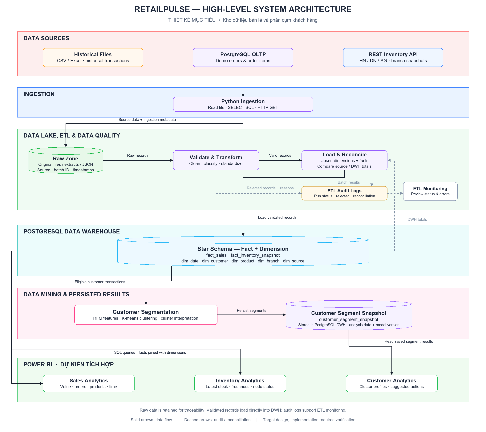
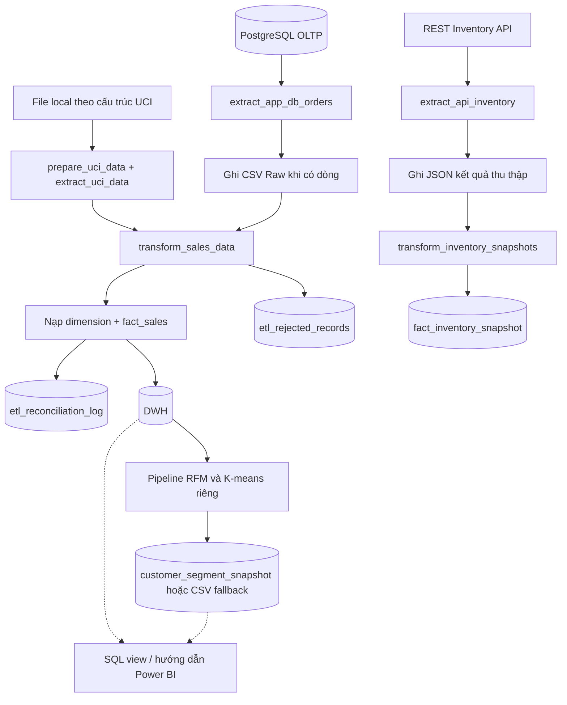

# RetailPulse — Tổng hợp hiện trạng hệ thống để phân tích

**Ngày đối chiếu:** 20/10/2026.  
**Repository:** `D:\CODE\bt\BTL_DATA_MINING`.  
**Commit tham chiếu:** `51324d8`.  
**Phạm vi:** kiến trúc, mã nguồn, cấu hình và sản phẩm có trong repository; đối chiếu với sơ đồ HLD và định hướng môn Kho dữ liệu và Khai phá dữ liệu.

> Đây là bản kiểm kê và đánh giá hiện trạng, không phải xác nhận nghiệm thu. Các nhận xét được rút ra từ việc đọc mã và kiểm tra tệp. Lần tổng hợp này không chạy lại Docker, ETL, ML, kiểm thử tích hợp hoặc Power BI. Có mã hoặc có tệp đầu ra không đồng nghĩa đã chạy thành công với dữ liệu hiện tại.

## Mục lục

1. [Nhận định tổng thể và cách đọc trạng thái](#tong-the)
2. [Kiến trúc và thành phần đang có](#kien-truc)
3. [Nguồn dữ liệu và cách lưu trữ](#du-lieu)
4. [Luồng ETL thực tế trong mã](#etl)
5. [Kho dữ liệu và mô hình chiều](#dwh)
6. [RFM, K-means và thực nghiệm](#mining)
7. [BI, OLAP và các điểm cần kiểm chứng](#bi-olap)
8. [Giao diện và mức độ tích hợp backend](#giao-dien)
9. [Các module mở rộng](#mo-rong)
10. [Các vấn đề cụ thể cần xử lý](#van-de)
11. [Sơ đồ cần bổ sung gì](#so-do)
12. [Những gì cần có để demo cho giảng viên](#demo)
13. [Thứ tự hoàn thiện và đầu ra](#uu-tien)
14. [Câu hỏi cần chốt và bản đồ mã nguồn](#tham-chieu)

<a id="tong-the"></a>
## 1. Nhận định tổng thể và cách đọc trạng thái

RetailPulse hiện có nền tảng cho một bài tập lớn gồm thu thập đa nguồn, ETL, kho PostgreSQL theo mô hình chiều, phân cụm RFM–K-means và giao diện quản trị. Repo đã có thêm hướng dẫn Power BI, công thức DAX, ba SQL view phục vụ BI, mã khảo sát K và kiểm tra ổn định giữa hai seed.

Ba khoảng cách lớn nhất để trình diễn có căn cứ:

1. **Luồng dữ liệu phải đúng và có thể kiểm chứng:** nguồn dữ liệu, định danh dòng, chống trùng, trạng thái nguồn, đối soát và tồn kho cần được kiểm tra đồng bộ.
2. **Giao diện phải phản ánh thực thi:** các nút ETL/ML đang có phần mô phỏng bằng JavaScript, chưa phải minh chứng pipeline Python chạy thật.
3. **Phân tích phải có sản phẩm thực tế:** có hướng dẫn và SQL/DAX nhưng chưa tìm thấy file Power BI; OLAP và diễn giải kết quả cần minh chứng tương tác và SQL đối chứng.

### 1.1. Ý nghĩa các trạng thái

| Trạng thái | Cách hiểu |
| --- | --- |
| Có mã/cấu hình | Đã tìm thấy triển khai; chưa xác nhận chạy đầu cuối trong lần kiểm tra này |
| Có sản phẩm trên đĩa | Tệp tồn tại; cần xác minh nguồn dữ liệu, cấu hình và lần chạy tạo tệp |
| Mô phỏng | Có hành vi minh họa hoặc số liệu sinh sẵn; không đại diện kết quả xử lý thực tế |
| Cần hoàn thiện | Có một phần nhưng còn lỗi, thiếu liên kết hoặc thiếu kiểm chứng |
| Chưa tìm thấy | Chưa thấy sản phẩm hoặc cấu hình tương ứng trong phần repository đã kiểm tra |
| Đề xuất | Công việc nên bổ sung; không khẳng định là rubric bắt buộc của giảng viên |

### 1.2. Bảng hiện trạng nhanh

| Thành phần | Hiện trạng | Nhận xét |
| --- | --- | --- |
| Ba nguồn File/DB/API | Có extractor | Cần phân biệt dữ liệu thực, demo và lỗi kết nối |
| Raw local | Có thư mục và mã ghi DB/API | Chưa có metadata và truy vết đầy đủ; đường dẫn API chưa thống nhất |
| Transform | Có mã | Có phân loại và tính chỉ tiêu; cần kiểm tra các trường hợp biên và cờ hủy từ DB |
| Nạp DWH | Có mã, DDL và Compose | Đối soát theo batch chưa lọc nguồn; định danh dòng và snapshot cần sửa |
| Rejected và reconciliation | Có hai bảng riêng | Nội dung rejected mới là tóm tắt; đối soát chạy lại chưa phân biệt dòng đã có |
| RFM | Có lọc nguồn, cửa sổ và khách hợp lệ | Cửa sổ tháng đang quy đổi gần đúng sang ngày; có fallback CSV |
| K-means | Có huấn luyện và lưu mô hình | Mặc định K=4 dù đã có đề xuất định lượng |
| Đánh giá K | Có inertia, silhouette, quy mô và ARI | ARI hiện so một seed chính với một seed phụ; cần diễn giải giới hạn |
| Power BI | Có hướng dẫn, DAX và ba SQL view | Chưa tìm thấy `.pbix`, `.pbip`, `.pbit`; các công thức/view còn điểm cần sửa |
| OLAP | Có dữ liệu chiều làm nền | Chưa xác nhận sản phẩm tương tác và minh chứng riêng |
| Portal web | Có các trang và JS | Nút pipeline và huấn luyện tùy chỉnh có phần mô phỏng |
| Kiểm thử | Có test module và script lỗi node | Chưa thấy bộ minh chứng đầu cuối cho ETL → DWH → ML → BI |
| Kafka/MDM/HMAC/Autoencoder/Haversine | Có module mở rộng | Tách khỏi luồng nghiệm thu chính; không suy diễn đã tích hợp hoàn chỉnh |

<a id="kien-truc"></a>
## 2. Kiến trúc và thành phần đang có

### 2.1. Sơ đồ mục tiêu hiện có trong repo



Tệp chỉnh sửa được: [RetailPulse_HLD_v3.drawio](docs/architecture/RetailPulse_HLD_v3.drawio). Mô tả phiên bản: [docs/architecture/README.md](docs/architecture/README.md).

HLD v3 chọn luồng **Ingestion → Raw → Validate & Transform → Load & Reconcile → DWH** và bỏ Curated riêng. Đây là lựa chọn kiến trúc được ghi trong tài liệu sơ đồ; cấu hình và đặc tả khác trong repo vẫn còn đề cập Curated, nên cần thống nhất lại.

### 2.2. Luồng đang được gọi trong pipeline chính



Sơ đồ trên mô tả lời gọi có trong mã, không xác nhận các dịch vụ hoặc lần chạy đã thành công. Lệnh ETL và lệnh ML hiện tách riêng. Portal chưa điều khiển đầy đủ chuỗi này qua backend.

### 2.3. Hạ tầng được cấu hình

| Thành phần | Tên trong Compose | Cổng host → container | Vai trò |
| --- | --- | --- | --- |
| PostgreSQL OLTP | `oltp-db` | `5432 → 5432` | Dữ liệu tác nghiệp demo |
| PostgreSQL DWH | `dwh-db` | `5433 → 5432` | Kho dữ liệu phân tích |
| FastAPI | `app` | `8001 → 8000` | API đơn hàng, tồn kho và chức năng nền |
| Python runner | `pipeline` | Không công bố | Chạy ETL/ML bằng lệnh |
| pgAdmin tùy chọn | `pgadmin` | `5050 → 80` | Kiểm tra CSDL |
| Portal local | `scripts/serve_frontend.py` | Mặc định `5173` | Phục vụ tệp giao diện tĩnh |

Các thư viện chính: pandas, NumPy, SQLAlchemy, psycopg2, requests, scikit-learn, matplotlib, seaborn, joblib, openpyxl và PyYAML.

Chưa tìm thấy cấu hình triển khai Debezium, MinIO, Airflow hoặc Superset. Không cần coi chúng là phần bắt buộc nếu đề bài của lớp không yêu cầu.

<a id="du-lieu"></a>
## 3. Nguồn dữ liệu và cách lưu trữ

### 3.1. Nguồn file lịch sử

- Cấu hình hiện trỏ tới `data_lake/raw/uci/online_retail_II.csv`.
- Extractor đọc CSV hoặc Excel, ánh xạ các trường Invoice, StockCode, Quantity, InvoiceDate, Price, Customer ID, Country.
- Khi CSV chưa có, `prepare_uci_data()` hiện **sinh 30.000 dòng tổng hợp** bằng `generate_synthetic_uci_dataset()`; không tự tải dữ liệu UCI thực.
- Vì vậy, tên file hoặc nhãn `UCI_HISTORICAL` chưa đủ chứng minh xuất xứ dữ liệu. Lần tổng hợp này không xác minh toàn bộ nội dung CSV hiện có.
- Nhánh Excel dùng `pd.read_excel()` không chỉ định nhiều sheet; nếu cần toàn bộ workbook thì phải xác định rõ sheet nào được đọc và cách giữ định danh dòng.

**Cần chốt:** dùng UCI thực hay mô phỏng; nguồn tải, checksum, số dòng, phạm vi ngày và cửa sổ phân tích. Không dùng số liệu của bộ UCI gốc để mô tả một file mô phỏng.

### 3.2. Nguồn PostgreSQL tác nghiệp

- `extract_app_db_orders()` JOIN các bảng `orders`, `order_items`, `products`, `branches`.
- Có trường mã đơn, sản phẩm, lượng, giá, khách, chi nhánh và cờ hủy.
- Khi có dữ liệu, pipeline ghi CSV vào `data_lake/raw/app_db/orders_<batch_id>.csv` trước khi transform.
- Khi truy vấn lỗi, extractor bắt ngoại lệ và trả DataFrame rỗng. Pipeline hiện có thể hiểu là “chưa có đơn” và ghi nhận nguồn thành công.
- Chưa lấy `order_items.id` làm định danh dòng nguồn; tham số `since_timestamp` chưa phải cơ chế CDC qua log.

### 3.3. Nguồn REST API tồn kho

- Cấu hình ba endpoint HN/DN/SG trong cùng dịch vụ FastAPI.
- Extractor gọi lần lượt từng nguồn, timeout thực tế trong mã là 2,5 giây; cấu hình timeout hiện ghi 3 giây.
- Thành công: nhận danh sách mặt hàng và `snapshot_time`.
- Lỗi: trả `OFFLINE`, danh sách rỗng, `snapshot_time = None`.
- Pipeline ghi kết quả thu thập thành JSON tại `data_lake/raw/inventory_api/`.
- Cấu hình lại dùng `data_lake/raw/api_inventory/`; cần thống nhất tên.
- JSON lưu là cấu trúc kết quả extractor, chưa giữ nguyên toàn bộ HTTP response và metadata HTTP.

Ba endpoint không tự chứng minh có ba máy chủ chi nhánh độc lập.

### 3.4. Trạng thái Data Lake

| Vùng | Hiện có gì? | Cần kiểm tra/bổ sung |
| --- | --- | --- |
| `raw/uci` | Có một CSV local | Xuất xứ thực hay mô phỏng; checksum và metadata |
| `raw/app_db` | Có mã ghi CSV; thư mục hiện chưa có tệp | Minh chứng một lần thu thập DB thành công |
| `raw/api_inventory` | Có cấu hình; thư mục hiện chưa có tệp | Sửa tên đường dẫn so với pipeline và tạo minh chứng |
| `raw/multi_store` | Có bốn tệp demo | Tách vai trò demo tích hợp khỏi lịch sử UCI |
| `raw/secure_staging` | Có tệp staging và nhật ký | Đây là nhánh mở rộng, không thay cho Raw đầy đủ của pipeline chính |
| `curated` | Có tên trong cấu hình; chưa thấy đầu ra dữ liệu trong lần kiểm kê | Chốt giữ/bỏ theo HLD v3, đồng bộ tài liệu |

Metadata còn cần hoàn thiện: nguồn, nhãn thực/mô phỏng, mã lần chạy, thời điểm thu thập, thời điểm tại nguồn, số dòng, định danh dòng và đường dẫn Raw.

<a id="etl"></a>
## 4. Luồng ETL thực tế trong mã

### 4.1. Điều phối

`run_etl_pipeline()` tạo `batch_id`, khởi tạo DWH/date dimension rồi xử lý các nguồn `uci`, `app`, `api` được chọn. Trạng thái cuối được in ra console là `FULL_SUCCESS`, `PARTIAL` hoặc `FAILED`.

**Giới hạn:** danh sách `failed_sources`/`success_sources` được khởi tạo sau nhánh UCI. Lỗi UCI chưa đi vào trạng thái tổng. API trả các node `OFFLINE` cũng có thể vẫn làm nhánh API được tính là thành công vì không phát sinh ngoại lệ ở cấp pipeline. Chưa thấy một bảng run registry đầy đủ ghi tiến độ từng bước cho portal đọc.

### 4.2. Transform bán hàng

Đã có các thao tác:

1. Chuẩn hóa chuỗi mã đơn/mã hàng; điền mô tả và chi nhánh `UNKNOWN`.
2. Chuyển lượng/đơn giá sang số.
3. Nhận diện hủy khi lượng âm hoặc mã đơn bắt đầu bằng `C`.
4. Tách đơn giá không hợp lệ/mã hàng thiếu sang rejected.
5. Tính `date_key`, `total_amount`, khách vãng lai và `record_hash`.

Điểm cần rà soát:

- Cờ `is_cancelled` từ DB bị tính lại theo lượng/mã đơn; đơn được đánh dấu hủy trong DB nhưng lượng còn dương và mã không bắt đầu `C` có thể mất cờ hủy.
- Lượng không hợp lệ được thay bằng 0 và ép integer, nhưng chưa được đưa vào quy tắc rejected tương ứng; lượng phân số có thể bị cắt phần thập phân.
- Hash gồm nguồn, mã đơn, mã hàng, lượng, giá và ngày. Nó chưa phải định danh dòng nguồn; có thể gộp hai dòng hợp lệ giống nhau hoặc không biểu diễn đúng một lần cập nhật.
- Khách thiếu mã được ánh xạ về bản ghi vãng lai; RFM đã có lọc `GUEST`, cần tiếp tục giữ quy tắc này.

### 4.3. Load bán hàng và đối soát

- Đồng bộ sản phẩm/khách theo nguồn; lấy khóa dimension; nạp `fact_sales` theo lô.
- Dùng `ON CONFLICT (record_hash) DO NOTHING`.
- Đã truy vấn lại DWH theo `batch_id` để lấy số dòng và tổng tiền.
- `reconcile_batch()` so số dòng nguồn với số dòng nạp cộng rejected, rồi so tổng tiền.

Hai vấn đề có thể làm sai đối soát:

1. Truy vấn kiểm tra ở loader chỉ lọc `batch_id`, chưa lọc nguồn. Nếu cùng batch đã nạp UCI rồi nạp App, kết quả kiểm tra App có thể gồm cả UCI.
2. Chạy lại cùng đầu vào tạo batch mới; dòng đã tồn tại không được chèn, nên không thuộc batch mới. Công thức hiện tại chưa phân biệt “đã tồn tại” với “bị thiếu”, có thể báo lệch dù chống trùng hoạt động.

Chưa có luồng fact upsert cập nhật hoàn chỉnh như nhãn “Upsert dimensions + facts” trên ảnh có thể khiến người đọc hiểu.

### 4.4. Tồn kho và lỗi nguồn

**Đã cải thiện so với bản cũ:** khi offline, extractor không gán thời điểm hiện tại; transformer/loader cho phép tồn và thời điểm là `NULL`; DDL có migration bỏ `NOT NULL`.

**Chưa hoàn chỉnh:**

- Trạng thái offline vẫn nằm ở dòng sản phẩm giả `ALL_PRODUCTS`, khác grain snapshot một sản phẩm thật.
- Chưa có trạng thái nguồn cấp chi nhánh độc lập để áp dụng cho các SKU cũ của chi nhánh đó.
- Unique theo `(date_key, branch_key, product_key, batch_id)` chưa chống nạp lại cùng snapshot giữa các batch khác nhau.
- Lookup sản phẩm trong loader tồn kho chưa lọc `source_key`, nên có thể nhầm khi các nguồn dùng trùng mã.
- `date_key` hiện dựa trên ngày máy chạy, cần đối chiếu với ngày thực của snapshot.
- Với phản hồi ONLINE nhưng danh sách rỗng, transformer đi vào nhánh tạo dòng OFFLINE; cần định nghĩa rõ “kho không có SKU” và “thu thập thất bại”.

### 4.5. Rejected và audit

Có `etl_rejected_records` và `etl_reconciliation_log`. Bản ghi rejected hiện lưu mô tả tóm tắt, chưa có liên kết chính xác về file/JSON và dòng nguồn. Ngưỡng đối soát trong hàm mặc định 0,05, trong YAML là 0,01; lời gọi pipeline chưa truyền ngưỡng cấu hình.

<a id="dwh"></a>
## 5. Kho dữ liệu và mô hình chiều

| Bảng | Vai trò và mức chi tiết mục tiêu | Hiện trạng đáng chú ý |
| --- | --- | --- |
| `fact_sales` | Một dòng giao dịch nguồn | Có khóa dimension, invoice, quantity, price, amount, cờ hủy, hash và batch |
| `fact_inventory_snapshot` | Một sản phẩm/chi nhánh/thời điểm chụp | Có nullable cho offline; cần tách trạng thái nguồn và bảo đảm grain |
| `dim_date` | Một ngày | Có ngày trong tháng/tuần, tháng, quý, năm |
| `dim_customer` | Khách trong từng nguồn | Unique `(source_key, customer_code)` |
| `dim_product` | Sản phẩm trong từng nguồn | Unique `(source_key, stock_code)` |
| `dim_branch` | Chi nhánh | Có `UNKNOWN`, HN, DN, SG |
| `dim_source` | Nguồn và tiền tệ | Phân biệt lịch sử và tác nghiệp |
| `customer_segment_snapshot` | Khách/ngày phân tích/phiên bản | Có RFM, tên cụm, `window_start`, `window_end` |
| `etl_rejected_records` | Dòng bị loại | Có lý do và batch; truy vết dòng còn thiếu |
| `etl_reconciliation_log` | Kết quả đối soát một nguồn trong batch | Cần phân biệt nạp mới/đã có/cập nhật |

Tiền và Monetary hiện dùng `DOUBLE PRECISION`; cần chốt kiểu thập phân, đơn vị và làm tròn để đối soát nhất quán. Bảng snapshot phân cụm nằm trong cùng DWH; hình cylinder riêng trên HLD là biểu diễn logic.

Chưa có Data Dictionary đầy đủ được xác nhận trong lần đọc này. Cần định nghĩa rõ đơn hàng, hủy/hoàn, doanh số mua, doanh thu thuần, AOV và tồn mới nhất. Không cộng tiền khác đơn vị hoặc tồn của nhiều mốc chụp.

<a id="mining"></a>
## 6. RFM, K-means và thực nghiệm

### 6.1. Những gì đã có

- Pipeline lấy nguồn `UCI_HISTORICAL` từ DWH.
- Có tham số cửa sổ, lọc ngày, giao dịch mua hợp lệ và loại khách `GUEST`.
- `T = window_end + 1 ngày`.
- R là số ngày từ lần mua gần nhất đến T; F là số hóa đơn phân biệt; M là tổng giá trị mua hợp lệ.
- Có `log1p`, `StandardScaler`, K-means với `n_init=20`, seed 42 trong huấn luyện.
- Khảo sát K=2..6; tính inertia, silhouette, quy mô cụm và ARI so với seed phụ 123.
- Lưu bảng so sánh K dạng CSV/JSON và biểu đồ Elbow–Silhouette.
- Lưu mô hình/scaler bằng joblib; gán tên cụm từ hồ sơ RFM.
- Export kết quả vào `customer_segment_snapshot` kèm cửa sổ; khi lỗi có fallback CSV.

### 6.2. Sản phẩm đang có trên đĩa

Trong `models/` có mô hình K=2/K=4, scaler, CSV phân cụm, bảng `k_comparison_summary.csv/.json`, biểu đồ đánh giá, artifact autoencoder và model registry. Sự tồn tại của các tệp chưa xác nhận tất cả cùng một bộ dữ liệu/cửa sổ hoặc được pipeline hiện tại tạo ra.

### 6.3. Các điểm cần kiểm chứng

| Nội dung | Hiện trạng | Việc cần làm |
| --- | --- | --- |
| Cửa sổ 12 tháng | Tính gần đúng bằng `window_months * 30.5` ngày | Dùng quy ước tháng lịch rõ ràng, kiểm tra biên đầu/cuối |
| Chọn K | Đã thử K nhưng mặc định K=4; chưa dùng `recommended_k` | Chọn theo kết quả hoặc ghi lý do nghiệp vụ dựa trên hồ sơ thực tế |
| Ổn định | ARI giữa hai seed | Ghi rõ đây là kiểm tra ban đầu; có thể mở rộng nhiều seed/cửa sổ |
| Dữ liệu nhỏ | Quét cố định K=2..6 | Kiểm tra số điểm/số điểm phân biệt và điều kiện tính silhouette |
| Diễn giải cụm | Tên tự gán theo quy tắc; cụm Monetary cao nhất được gọi VIP | Rà soát thêm R/F; không coi tên là kết luận đã được chứng minh |
| Baseline đối chứng | Chưa thấy bài thực nghiệm rule-based RFM riêng | Có thể bổ sung để giải thích giá trị của K-means; GMM là tùy chọn |
| Phiên bản | Nhãn chủ yếu dạng `kmeans-k4` | Lưu thêm dữ liệu, cửa sổ, seed, cấu hình, mã lần chạy và phiên bản thư viện |
| Fallback | Đọc CSV và có mốc cuối mặc định 09/12/2011 | Tách chế độ offline; không âm thầm coi là luồng DWH thành công |

Fallback dùng mã khách CSV làm `customer_key`; khóa đó không đảm bảo bằng surrogate key trong DWH. Khi DB phục hồi phải ánh xạ lại trước khi xuất kết quả.

Silhouette không phải accuracy hoặc mức tăng doanh thu. Nhãn “At Risk” theo RFM chưa phải xác suất rời bỏ. Gợi ý chăm sóc là diễn giải, chưa có thử nghiệm đo tác động kinh doanh.

<a id="bi-olap"></a>
## 7. BI, OLAP và các điểm cần kiểm chứng

### 7.1. Sản phẩm đã có

- [Hướng dẫn Power BI](bi/POWER_BI_GUIDE.md): định hướng ba trang bán hàng, tồn kho, khách hàng.
- [Tập công thức DAX](bi/DAX_MEASURES.md).
- Ba view: [sales](bi/views/01_vw_sales_analytics.sql), [inventory](bi/views/02_vw_inventory_status.sql), [customer segments](bi/views/03_vw_customer_segments.sql).
- Chưa tìm thấy file `.pbix`, `.pbip` hoặc `.pbit` trong repo tại thời điểm kiểm kê.

### 7.2. Những điểm cụ thể trong SQL/DAX

1. **View bán hàng tham chiếu cột không khớp DDL:** dùng `dd.day`, trong DDL là `day_of_month`. Nếu DB theo DDL hiện tại thì view cần sửa tên/alias trước khi tạo.
2. **Dấu hủy/hoàn:** transformer lưu amount âm khi quantity âm; DAX hiện tính `Net Sales = Gross Sales - Refund Amount`, còn view đảo dấu amount của dòng hủy. Với hoàn trả âm, cả hai cách có thể cộng ngược giá trị hoàn vào doanh số. Ví dụ mua 100, hoàn -20: kết quả mong đợi theo bù trừ là 80, không phải 120. Cần chốt một quy ước dấu và kiểm tra đơn hủy có amount dương riêng.
3. **Hướng dẫn kết nối chưa khớp cấu hình:** tên DB trong guide là `retailpulse_dwh`, còn Compose/YAML là `retail_dwh_db`; user trong guide cũng khác Compose. Không cần đưa mật khẩu vào tài liệu tổng hợp này.
4. **Tồn kho:** view lấy bản nạp mới nhất theo branch/product; cần phân biệt thời điểm nạp và thời điểm snapshot. Dòng `ALL_PRODUCTS` offline không tự làm các SKU cũ chuyển trạng thái offline.
5. **DAX trạng thái node:** `SELECTEDVALUE(..., "ONLINE")` có thể hiển thị ONLINE khi có nhiều trạng thái; cần định nghĩa trạng thái hiện tại theo chi nhánh/lần gọi.
6. **DAX tồn thấp:** chưa chốt cùng phạm vi snapshot mới nhất; có thể đếm SKU từ dữ liệu lịch sử. Cần làm rõ có tính SKU tồn 0 hay không.
7. **Số đơn:** DISTINCTCOUNT invoice một mình có thể gộp mã trùng giữa nguồn; cần lọc một nguồn hoặc định danh đơn gồm nguồn.
8. **Phân cụm trên BI:** phải chọn một ngày/phiên bản/cửa sổ để không cộng Monetary hoặc tính trung vị trên nhiều snapshot của cùng khách.

Đây là các nhận xét từ mã/tài liệu, chưa phải kết quả chạy DAX trong Power BI Desktop.

### 7.3. OLAP cần thể hiện thêm

Nền Star Schema đã có, nhưng chưa xác nhận sản phẩm tương tác thể hiện đầy đủ:

| Thao tác | Ví dụ demo cần chuẩn bị |
| --- | --- |
| Roll-up và drill-down | Ngày ↔ tháng ↔ quý ↔ năm |
| Slice | Chọn một năm hoặc một nguồn |
| Dice | Lọc đồng thời thời gian, sản phẩm, quốc gia |
| Pivot | Đổi trục bảng phân tích |
| Drill-through | Từ KPI/tổng hợp mở danh sách giao dịch tương ứng |

Nên thể hiện **Power BI Semantic Model: quan hệ + KPI/measures + hierarchies** và **OLAP interactions** bên trong khối BI của sơ đồ. Không bắt buộc thêm máy chủ cube riêng. Chỉ dùng chiều/hierarchy thực sự có dữ liệu đáng tin cậy; lịch sử UCI không tự có chi nhánh Việt Nam.

<a id="giao-dien"></a>
## 8. Giao diện và mức độ tích hợp backend

### 8.1. Những trang đang có

`frontend/` có trang giới thiệu, dashboard, operations, ETL monitor và customer segments. Script `scripts/serve_frontend.py` phục vụ tệp tĩnh và tắt cache; bản thân server này không phải bộ thực thi ETL/ML.

FastAPI có mã API đơn hàng và tồn kho. Chưa tìm thấy API điều phối các lần chạy ETL/ML và lấy tiến độ tương ứng với các nút mô phỏng đã kiểm tra.

### 8.2. Phần mô phỏng xác nhận từ mã

| Vị trí | Hành vi hiện tại | Ý nghĩa khi demo |
| --- | --- | --- |
| `frontend/etl-monitor.html`, `runAsyncPipeline()` | Đổi bước qua `setTimeout`, tự báo thành công sau chuỗi thời lượng cố định | Không chứng minh Python/DB đã thực hiện |
| Console sự kiện | Sinh nhánh/amount/HMAC minh họa bằng random | Không chứng minh sự kiện từ broker hoặc chữ ký được kiểm tra |
| `frontend/js/dataops-engine.js`, `trainCustomModel()` | Tính metric bằng heuristic và random; lưu registry localStorage | Không phải huấn luyện scikit-learn thực tế |
| Operations | Fetch các file demo multi-store local | Chứng minh đọc file demo; không tự chứng minh truy vấn SQL/API chi nhánh |
| Registry/activation | Có mẫu cấu hình, metric khởi tạo và dữ liệu preview | Cần phân biệt mẫu với kết quả mô hình và endpoint triển khai thật |

### 8.3. Cần có để giao diện phản ánh luồng thật

- Backend tạo run, trả `run_id` và trạng thái.
- Worker/runner chạy tác vụ và lưu log/số đếm theo bước.
- Portal đọc trạng thái từ backend, hiển thị cả lỗi và thành công một phần.
- Xem dữ liệu Raw, trước/sau transform, rejected, DWH và đối soát theo cùng run.
- Màn hình ML đọc artifact/metric do Python tạo, có liên kết dataset/cửa sổ/mô hình.
- Chế độ demo mô phỏng nếu giữ lại phải có nhãn riêng và không được dùng làm minh chứng chạy thật.

<a id="mo-rong"></a>
## 9. Các module mở rộng

| Module | Repo đã có gì? | Cách trình bày đúng phạm vi |
| --- | --- | --- |
| Kafka-like broker | Topic/partition/message trong bộ nhớ Python | Mô phỏng sự kiện; chưa phải Apache Kafka triển khai |
| Canonical/MDM | Model chung, mapping SKU, tiền tệ và chống trùng demo | Nhánh tích hợp bổ sung, cần chứng minh nguồn và quy tắc |
| HMAC staging | Sinh/kiểm tra HMAC và log staging | HMAC xác thực thông điệp dùng khóa chia sẻ; không đồng nghĩa mã hóa nội dung hay chữ ký số khóa công khai |
| Autoencoder | MLPRegressor, latent features và clustering | Thực nghiệm bổ sung; chưa thay thế pipeline RFM chính |
| Haversine | Khoảng cách mặt cầu và chọn kho có tồn dư gần | Gợi ý theo khoảng cách; chưa đủ chứng minh tối ưu tuyến đường/chi phí thực tế |
| Model registry | Lưu JSON, giá trị khởi tạo, quản lý phiên bản | Metric khởi tạo chưa phải kết quả của lần huấn luyện hiện tại |
| CRM activation | Sinh cấu hình endpoint và khách mẫu | Không coi preview hoặc URL được sinh là API đang phục vụ thực tế |

Autoencoder hiện so silhouette trong không gian latent với silhouette của RFM trong không gian khác. Các con số không tự chứng minh cải thiện chất lượng nghiệp vụ. Phần lấy bottleneck cũng cần rà soát activation theo cấu hình mạng trước khi dùng làm kết quả nghiên cứu.

Chưa cần đưa các mở rộng này vào luồng demo cốt lõi nếu còn thiếu kiểm chứng ETL, OLAP và phân cụm.

<a id="van-de"></a>
## 10. Các vấn đề cụ thể cần xử lý

**P0:** có thể làm sai số liệu/trạng thái hoặc làm demo không phản ánh thực thi. **P1:** cần để kết quả có thể giải thích và tái lập. **P2:** hoàn thiện hoặc mở rộng. Đây là mức ưu tiên đề xuất, không phải điểm môn học.

| ID | Mức | Vấn đề | Căn cứ | Hướng xử lý |
| --- | --- | --- | --- | --- |
| R01 | P0 | UI pipeline/huấn luyện có phần mô phỏng | `etl-monitor.html`, `dataops-engine.js` | Nối run backend thật; metric đọc từ Python |
| R02 | P0 | Xuất xứ CSV chưa được xác nhận | `data_downloader.py` sinh dữ liệu khi thiếu file | Tách nguồn thật/mô phỏng; lưu provenance |
| R03 | P0 | Audit loader chỉ lọc batch, có thể cộng cả nguồn khác | `load_fact_sales()` | Lọc nguồn và đúng tập khóa cần đối soát |
| R04 | P0 | Đối soát chạy lại chưa tính dòng đã có | `DO NOTHING` và `reconcile_batch()` | Tách inserted/updated/unchanged/rejected; so cùng tập đầu vào/đích |
| R05 | P0 | Trạng thái tổng bỏ sót UCI và node API offline | `run_etl_pipeline()` | Ghi trạng thái mỗi nguồn/chi nhánh ngay từ đầu |
| R06 | P0 | DB lỗi bị trả như tập rỗng thành công | `extract_app_db_orders()` | Trả/raise lỗi rõ, phân biệt “0 dòng” và “nguồn lỗi” |
| R07 | P0 | View sales dùng `dd.day` không có trong DDL | SQL view và `dim_date` | Sửa tên, thực thi view trên schema thực |
| R08 | P0 | Quy tắc dấu hoàn trả gây sai net sales | Transformer, SQL view, DAX | Chốt dấu và test ví dụ mua/hoàn/hủy |
| R09 | P1 | Hash chưa phải định danh dòng; cờ hủy DB bị ghi đè | `transform_sales_data()` | Dùng khóa dòng nguồn; bảo toàn quy tắc hủy đúng nguồn |
| R10 | P1 | Snapshot/offline/lookup sản phẩm chưa nhất quán | Inventory loader/view | Trạng thái cấp chi nhánh, source-aware lookup và khóa snapshot |
| R11 | P1 | Thử K nhưng chọn K=4 mặc định | Mining pipeline/evaluation | Chọn theo thực nghiệm hoặc ghi lý do có căn cứ |
| R12 | P1 | Cửa sổ tháng gần đúng; fallback che lỗi DWH | RFM extractor/exporter | Tháng lịch, chế độ offline tường minh và metadata |
| R13 | P1 | Có SQL/DAX nhưng chưa có báo cáo BI xác nhận | `bi/`, không thấy file Power BI | Tạo report, quan hệ, OLAP và SQL đối chứng |
| R14 | P1 | DAX/view tồn kho và snapshot khách cần lọc đúng | DAX, inventory/customer view | Kiểm tra nhiều nguồn, nhiều batch, nhiều phiên bản |
| R15 | P1 | Cấu hình/tài liệu không khớp | Path API, timeout, tolerance, DB name | Một nguồn cấu hình thống nhất và hướng dẫn đúng |
| R16 | P1 | Thiếu truy vết tới từng dòng Raw | Extractor, rejected summary | Giữ source row ID, Raw URI và manifest |
| R17 | P2 | Đặc tả/README còn trạng thái cũ hoặc tuyên bố rộng | Spec và HLD README | Đồng bộ hiện trạng, bỏ khẳng định chưa có minh chứng |

<a id="so-do"></a>
## 11. Sơ đồ cần bổ sung gì

Giữ các khối Sources, Ingestion, Raw, Transform, Load/Reconcile, DWH, Mining và BI. HLD không cần biến thành chín tầng tương ứng chín chương báo cáo.

| Bổ sung/làm rõ | Vị trí |
| --- | --- |
| Run controller và lịch sử trạng thái | Cạnh Ingestion/ETL, liên kết portal monitoring |
| Source metadata và lineage | Gắn Raw với batch và định danh dòng |
| Rejected Data riêng | Nhánh từ Validate & Transform; Audit Logs ghi thông tin lần chạy |
| Trạng thái nguồn và freshness | Nhánh API/ETL và báo cáo inventory |
| Data selection, RFM, preprocessing, evaluation | Sơ đồ chi tiết mở rộng khối Customer Segmentation |
| Semantic model và OLAP interactions | Bên trong khối Power BI |
| SQL/manual validation | Liên kết DWH, RFM và BI |
| Snapshot phân cụm thuộc DWH | Giữ chú thích vật lý, tránh hiểu là thêm CSDL |

Business Questions/KPI và giới hạn sử dụng đặt ở tài liệu yêu cầu hoặc chú thích; grain/data dictionary đặt ở ERD/tài liệu thiết kế. Có thể giữ thiết kế v3 không lưu Curated riêng nếu Raw, quy tắc transform và khả năng chạy lại đã được xác định rõ.

<a id="demo"></a>
## 12. Những gì cần có để demo cho giảng viên

### 12.1. Chuỗi trình diễn có thể kiểm chứng

| Bước | Thao tác | Minh chứng |
| --- | --- | --- |
| 1 | Giới thiệu câu hỏi và sơ đồ | Phân biệt DW, OLAP, Mining và đầu ra |
| 2 | Mở ba nguồn | File, bảng DB và JSON API; nhãn nguồn thật/demo |
| 3 | Chạy ingestion/ETL | Run ID, tiến độ backend, Raw và số dòng |
| 4 | Xem trước/sau và rejected | Một vài dòng với quy tắc và lý do rõ |
| 5 | Kiểm tra DWH/đối soát | Dimension/fact, số dòng và tổng tiền theo nguồn |
| 6 | Chạy lại cùng đầu vào | Không tăng sai số dòng/tiền; có số dòng đã tồn tại |
| 7 | Thực hiện OLAP | Hierarchy, slice/dice, pivot/drill-through và SQL đối chứng |
| 8 | Chạy/xem thực nghiệm mining | RFM, K, metric, ổn định và hồ sơ cụm |
| 9 | Xem kết quả trên BI | Ngày/phiên bản/cửa sổ đúng; gợi ý có giới hạn |
| 10 | Ngắt API rồi phục hồi | Trạng thái thiếu/cũ đúng, nguồn khác tiếp tục, đồng bộ có kiểm soát |

### 12.2. Một giao dịch phải truy được từ đầu đến cuối

```text
Nguồn và định danh dòng
→ Raw + lần thu thập
→ Giá trị trước/sau transform
→ Fact và dimension tương ứng
→ Kết quả đối soát
→ KPI/chi tiết trên BI
→ Đóng góp vào RFM nếu đủ điều kiện
```

Bộ demo nhỏ dùng để giải thích ETL cần có mua hợp lệ, thiếu khách, hủy/hoàn, giá không hợp lệ, dòng giống nhau hợp lệ và chạy lại. Thực nghiệm mining dùng cửa sổ lịch sử đã chốt; không trộn dữ liệu demo tùy ý vào mô hình lịch sử.

### 12.3. Kiểm thử hiện có chưa chứng minh toàn bộ chuỗi

Các test hiện tập trung vào module DataOps, tích hợp heterogeneous, broker mô phỏng, HMAC, Haversine và artifact Autoencoder. Một test Autoencoder đọc JSON metric đã lưu rồi assert chỉ số; điều đó chưa chứng minh lại quá trình huấn luyện hoặc chất lượng trên dữ liệu hiện tại.

`scripts/test_fault_node.py` gọi extractor/transformer và in kết luận, chưa có assertion kiểm tra lưu DWH, giữ dữ liệu cũ, BI và phục hồi. Lần tổng hợp này không chạy các test vì chúng có thể ghi artifact/log và không cần thiết để tạo bản kiểm kê.

<a id="uu-tien"></a>
## 13. Thứ tự hoàn thiện và đầu ra

| Giai đoạn | Việc làm | Tiêu chí hoàn thành |
| --- | --- | --- |
| A. Chốt dữ liệu và chỉ tiêu | Nguồn thật/demo, cửa sổ, grain, định danh, dấu hoàn và tiền tệ | Source audit, Data Dictionary và KPI definitions |
| B. Làm đúng ETL/DWH | Sửa R03–R10; thống nhất cấu hình; metadata và trạng thái run | Kiểm thử ba nguồn, chạy lại, cập nhật và API lỗi bằng dữ liệu đích |
| C. Nối portal với thực thi | API/runner, trạng thái từng bước, log và preview dữ liệu | Nút chạy tạo tác vụ thật; lỗi/thành công không đầy đủ hiển thị đúng |
| D. Hoàn thiện mining | Cửa sổ lịch, chọn K, kiểm tra ổn định, metadata và hồ sơ | Thực nghiệm tái lập, kết quả có căn cứ |
| E. BI/OLAP | Sửa view/DAX, kết nối đúng DWH, làm report và SQL đối chứng | File Power BI và minh chứng thao tác đa chiều |
| F. Tích hợp và báo cáo | Truy vết giao dịch, lỗi/khôi phục, đồng bộ tài liệu | Demo đầu cuối có minh chứng và giới hạn rõ |

Có thể phát triển BI và mining song song khi hợp đồng dữ liệu DWH đã ổn định. Không cần chờ xây xong một portal lớn mới kiểm tra SQL, RFM hoặc Power BI.

### Đầu ra để nhóm tự đánh giá

- [ ] Dữ liệu đầu vào có xuất xứ và phân biệt demo.
- [ ] Raw đầy đủ ba nguồn và truy được dòng.
- [ ] ETL xử lý đúng mua/hủy/hoàn/lỗi, có số đếm theo trạng thái.
- [ ] Chạy lại không nhân đôi giao dịch/snapshot.
- [ ] Đối soát theo đúng nguồn, kỳ, tiền tệ và tập khóa.
- [ ] DWH có ERD, grain, Data Dictionary và KPI definitions.
- [ ] OLAP có thao tác thực tế và SQL đối chứng.
- [ ] RFM được kiểm tra thủ công trên khách mẫu.
- [ ] Chọn K và hồ sơ cụm có bằng chứng; metadata tái lập.
- [ ] Portal dùng trạng thái thực, mô phỏng có nhãn riêng.
- [ ] Có file báo cáo Power BI và chọn đúng snapshot/model.
- [ ] Thử API lỗi/phục hồi được kiểm chứng ở dữ liệu đích.
- [ ] Tài liệu phản ánh đúng triển khai và giới hạn.

<a id="tham-chieu"></a>
## 14. Câu hỏi cần chốt và bản đồ mã nguồn

### 14.1. Câu hỏi để tiếp tục phân tích

1. Đề bài/slide hiện tại của thầy bắt buộc những gì về nguồn, BI, OLAP, ML và công nghệ?
2. CSV đang dùng là UCI thực hay tổng hợp? Có bản gốc và metadata không?
3. Hệ thống xử lý theo batch ở thời điểm nào? Có cần incremental/update/delete hay chỉ append?
4. Định nghĩa dòng giao dịch và đơn hàng phân biệt theo nguồn ra sao?
5. Hủy, hoàn và giá trị âm được tính thế nào trong từng KPI?
6. Tồn kho hiện tại là snapshot mới nhất tại nguồn hay bản nạp cuối? Cần lưu trạng thái chi nhánh ở đâu?
7. Cửa sổ và tiêu chí chọn K nào được dùng cho kết quả nộp?
8. Portal là màn hình vận hành thật hay có một chế độ mô phỏng riêng?
9. Ai chịu trách nhiệm SQL đối chứng, mô hình Power BI và minh chứng OLAP?

### 14.2. Mã nguồn và tài liệu để kiểm tra tiếp

| Nhóm | Tệp tham chiếu |
| --- | --- |
| Phạm vi | [decuong.txt](decuong.txt), [đặc tả kiến trúc](SYSTEM_ARCHITECTURE_DRAWIO_SPEC.md) |
| Hạ tầng | [Compose](docker-compose.yml), [config](config/config.yaml), [requirements](requirements.txt) |
| HLD | [README](docs/architecture/README.md), [Draw.io](docs/architecture/RetailPulse_HLD_v3.drawio) |
| Nguồn/Raw | [data_downloader](src/utils/data_downloader.py), [extractors](src/etl/extractors.py) |
| ETL | [pipeline](src/etl/pipeline.py), [transformers](src/etl/transformers.py), [loaders](src/etl/loaders.py), [quality_check](src/etl/quality_check.py) |
| Schema | [OLTP](sql/01_init_oltp.sql), [DWH](sql/02_init_dwh.sql), [SQL kiểm tra](sql/03_reconciliation.sql) |
| Mining | [pipeline](src/mining/pipeline.py), [RFM](src/mining/rfm_extractor.py), [clustering](src/mining/clustering.py), [evaluation](src/mining/evaluation.py), [exporter](src/mining/segment_exporter.py) |
| BI | [guide](bi/POWER_BI_GUIDE.md), [DAX](bi/DAX_MEASURES.md), [sales view](bi/views/01_vw_sales_analytics.sql), [inventory view](bi/views/02_vw_inventory_status.sql), [customer view](bi/views/03_vw_customer_segments.sql) |
| Portal | [ETL monitor](frontend/etl-monitor.html), [customer segments](frontend/customer-segments.html), [operations](frontend/operations.html), [JS engine](frontend/js/dataops-engine.js), [server tĩnh](scripts/serve_frontend.py) |
| Backend | [orders API](fastapi-base/app/api/v1/api_orders.py), [inventory API](fastapi-base/app/api/v1/api_inventory.py) |
| Demo/test | [run_all](scripts/run_all.bat), [fault node](scripts/test_fault_node.py), [four pillars test](tests/test_four_pillars.py) |

Các nhận định “chuẩn học phần”, điểm số hoặc công nghệ bắt buộc cần được đối chiếu đề bài của giảng viên. Tài liệu này giúp nhóm phân tích hệ thống đang có và khoảng cách cần hoàn thiện; không thay thế rubric, kết quả chạy hoặc báo cáo thực nghiệm.
