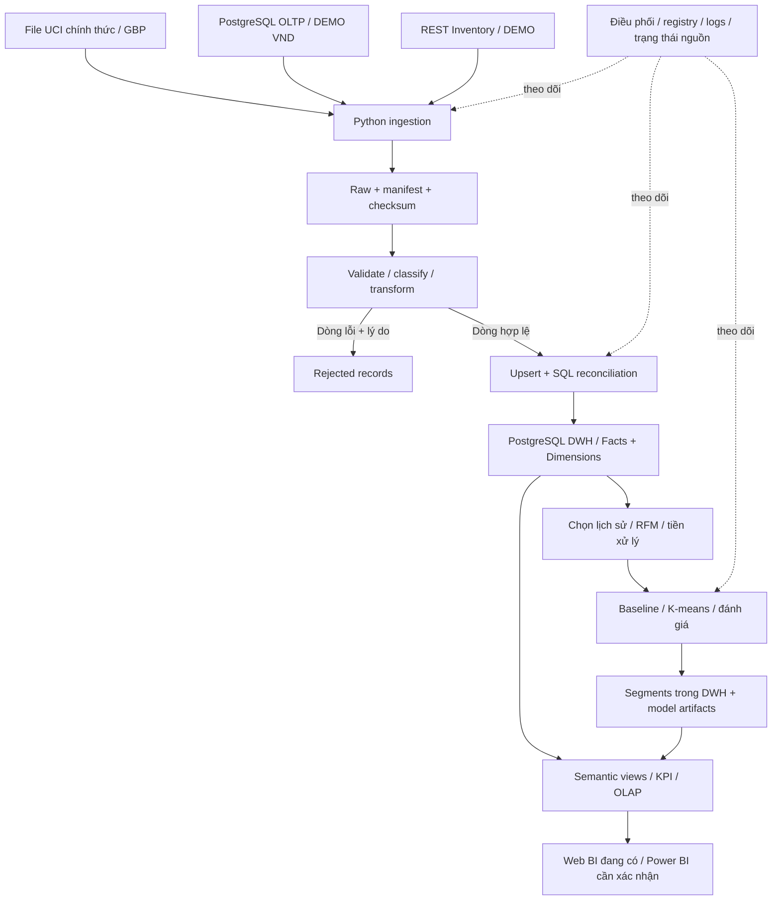

# RetailPulse: từ cổng quản trị sang trình diễn luồng dữ liệu

Ngày phân tích: 24/10/2026.

Cơ sở: sơ đồ `image.png` do người dùng cung cấp; mã giao diện, API, ETL, mining và các tài liệu trong repository được đọc tại thời điểm phân tích. Đây là đánh giá thiết kế và cách trình bày. Không chạy lại dịch vụ hoặc toàn bộ kiểm thử trong lần viết tài liệu này. Bằng chứng thực thi trước đó được dẫn riêng ở cuối tài liệu; không coi việc đọc mã là một lần nghiệm thu mới.

## 1. Trả lời trực tiếp: hệ thống có thiên về quản trị không?

**Giao diện và cách kể chuyện có xu hướng thiên về quản trị; kiến trúc xử lý cốt lõi vẫn là hệ thống kho dữ liệu và khai phá dữ liệu.** Hai nhận định này không mâu thuẫn.

Backend đã có thu thập đa nguồn, Raw, kiểm tra chất lượng, chuẩn hóa, Star Schema, đối soát, OLAP, RFM và thực nghiệm phân cụm. Những thành phần này phục vụ đúng bài toán dữ liệu. Vấn đề nằm ở việc người xem dễ nhìn thấy nhiều màn hình, nút chạy và trạng thái hơn là hiểu một bản ghi đã thay đổi như thế nào.

Một buổi demo dành quá nhiều thời gian cho container, nút trigger, trạng thái SUCCESS, model registry và bảng log sẽ giống buổi giới thiệu công cụ quản trị. Một buổi demo theo dấu dòng nguồn → Raw → dòng chuẩn hóa → Fact → số tổng hợp → đặc trưng khách hàng → kết quả khai phá sẽ thể hiện được nội dung học phần rõ hơn.

Không có rubric hiện hành của giảng viên trong phạm vi đối chiếu này. Các ưu tiên dưới đây là đề xuất cho mục tiêu nhóm đã nêu, không phải tuyên bố mọi công nghệ hoặc màn hình đều là yêu cầu bắt buộc của PTIT.

### 1.1. Ba phần khác nhau trong một hệ thống

| Phần | Câu hỏi phải trả lời | Ví dụ trong RetailPulse | Vai trò khi bảo vệ |
|---|---|---|---|
| Xử lý dữ liệu | Dữ liệu đến từ đâu, được xử lý và lưu thế nào? | Extractors, Raw, transformers, loaders, DWH | Trục trình bày chính |
| Phân tích và khai phá | Dữ liệu trả lời được câu hỏi nào, kết luận có căn cứ gì? | OLAP, RFM, K-means, đánh giá, hồ sơ cụm | Trục trình bày chính |
| Điều phối và giám sát | Ai chạy tác vụ, khi nào chạy, lỗi ở đâu? | Portal runner, registry, logs, Airflow, MinIO Console | Bằng chứng hỗ trợ |

Không nên bỏ điều phối và giám sát. Chúng giúp chứng minh kết quả có thật và truy vết được. Tuy nhiên, mỗi lần mở log hoặc trạng thái phải gắn với một câu hỏi dữ liệu cụ thể.

Ví dụ: “Có 3 dòng nguồn nhưng chỉ có 1 đơn mua, vì sao?” có giá trị giải thích cao hơn “Pipeline đang SUCCESS”.

## 2. Đọc kỹ sơ đồ trong ảnh

### 2.1. Điểm đúng nên giữ

1. Phân biệt ba loại nguồn: File lịch sử, PostgreSQL OLTP và REST API tồn kho.
2. Có bước ingestion trước lưu Raw; không đưa dữ liệu vào dashboard ngay từ nguồn.
3. Tách kiểm tra/biến đổi khỏi nạp/đối soát.
4. Có nhánh bản ghi bị loại và lý do, thay vì chỉ mô tả luồng thành công.
5. DWH sử dụng Fact và Dimension, phù hợp nhu cầu tổng hợp đa chiều.
6. Data Mining đọc từ DWH và lưu kết quả phân khúc trước khi đưa vào BI.
7. BI đọc cả dữ liệu nghiệp vụ và kết quả khai phá. Đây là hai đầu ra khác nhau.

Sơ đồ không sai chỉ vì có ETL Monitoring. Khối này nhỏ, có vai trò hỗ trợ. Cảm giác thiên về quản trị chủ yếu xuất hiện khi giao diện và buổi trình diễn dành nhiều thời gian hơn cho nó so với các khối dữ liệu.

### 2.2. Những gì ảnh chưa thể hiện đủ

| Vị trí trong ảnh | Điều chưa rõ | Nên bổ sung vào sơ đồ hoặc hình minh họa đi kèm |
|---|---|---|
| Ba nguồn | Nguồn nào là dữ liệu lịch sử thật, nguồn nào DEMO; có được ghép không? | UCI chính thức/GBP; OLTP và inventory DEMO/VND; ranh giới dữ liệu |
| Mũi tên tới ingestion | Đầu vào có những trường gì? | Mẫu CSV, bảng SQL, JSON API với vài trường chính |
| Python Ingestion | Đọc toàn bộ hay tăng dần? Dùng SELECT có phải CDC không? | Ghi đúng phương pháp hiện có; không gắn Debezium nếu chưa triển khai |
| Raw Zone | Lưu ở đâu, nhận diện bản Raw nào? | MinIO theo profile/local mirror; run_id, checksum, manifest |
| Validate & Transform | Clean/classify/standardize cụ thể là gì? | Các quy tắc, bảng trước/sau, ví dụ hợp lệ/lỗi/hủy/hoàn |
| Nhánh rejected | Lưu dòng lỗi hay chỉ có thông báo lỗi? | Dữ liệu gốc + rejection_reason + nguồn/batch |
| Load & Reconcile | So tổng nào với tổng nào? | Đúng source identity, currency và tập dòng; inserted/updated/unchanged |
| Star Schema | Mỗi dòng Fact đại diện điều gì? | Grain riêng của Sales và Inventory; source-aware identity |
| DWH → BI | Phân tích đa chiều được thực hiện ở đâu? | Semantic SQL views/KPI và OLAP, trước màn hình BI |
| Customer Segmentation | RFM tính thế nào, chọn K và đánh giá ra sao? | Chuỗi chọn dữ liệu → RFM → preprocessing → baseline/K-means → evaluation |
| Segment Snapshot | Thuộc khách, cửa sổ và mô hình nào? | Customer key, window, analysis date, model version, mining run_id |
| Power BI | Đây là sản phẩm đã mở kiểm chứng hay thiết kế mục tiêu? | Phân biệt web BI đang có với Power BI Desktop chưa được xác nhận |

### 2.3. Các điểm dễ gây hiểu nhầm cần sửa cách ghi

**Customer Segment Snapshot là dữ liệu được lưu trong PostgreSQL DWH.** Trong ảnh, nó nằm ở một tầng riêng nên người xem có thể nghĩ đây là một CSDL độc lập. Có thể giữ vị trí đó để mô tả bước sinh kết quả, nhưng ghi rõ “bảng kết quả trong DWH”, nối tới lớp phân tích chung.

**Nhánh bị loại cần có nơi lưu riêng rõ ràng.** Dòng dữ liệu lỗi và log thực thi không cùng một loại dữ liệu. Trên sơ đồ chi tiết nên tách “Rejected records + reasons” và “Run/Audit metadata”, dù triển khai cùng PostgreSQL hoặc cùng hệ thống artifact.

**Tồn kho cần trạng thái thu thập nguồn riêng.** Một nguồn OFFLINE không tạo ra snapshot tồn kho 0. BI phải đọc snapshot hợp lệ gần nhất và trạng thái/freshness của nguồn; hai thông tin bổ sung cho nhau.

**Ba endpoint HN/DN/SG hiện là ba nguồn logic trong cùng ứng dụng API DEMO.** Không vẽ hoặc giới thiệu chúng thành ba máy chủ vật lý độc lập.

**Raw → DWH không có Curated vật lý riêng vẫn chấp nhận được trong thiết kế nhóm.** Tuy nhiên, phải giải thích được dữ liệu trung gian đã biến đổi và có thể tái tạo nó. Một bảng mẫu trước/sau phục vụ giải thích không đồng nghĩa phải thêm kho Curated mới.

## 3. Kiến trúc nên trình bày theo hai hình

Một hình tổng quan không nên gánh toàn bộ chi tiết của ETL, ERD và thí nghiệm ML. Giữ một hình kiến trúc và thêm một hình luồng dữ liệu có mẫu bản ghi.

### 3.1. Hình tổng quan đề xuất



Mũi tên liền mô tả luồng dữ liệu. Mũi tên nét đứt mô tả điều phối/giám sát. Airflow là công cụ điều phối, không phải một bước biến đổi dữ liệu độc lập. MinIO là nơi lưu Raw, không tự làm sạch dữ liệu.

### 3.2. Hình luồng chi tiết cần đặt cạnh hình tổng quan

```text
DÒNG NGUỒN                 RAW                 CHUẨN HÓA                  DWH
order_items.id       →     giữ bản trích   →    source_record_id     →     fact_sales
quantity                   xuất ban đầu        transaction_type          source_key
unit_price                                     total_amount              date_key
is_cancelled                                   currency                  product_key
invoice_date                                   provenance                customer_key
                                                                         raw_path/run_id
                                                                             ↓
                                                               SQL theo cùng bộ lọc
                                                                             ↓
                                                               KPI / bảng OLAP / BI
```

Đây là phần giúp thầy nhìn thấy “đi như thế nào”. Chỉ phát sáng các hộp kiến trúc hoặc chạy hoạt ảnh mũi tên chưa thể thay thế bảng dữ liệu trước/sau.

## 4. Luồng bán hàng: phải cho thấy giá trị thay đổi ra sao

### 4.1. Một phiên nhỏ để giải thích ETL

Trang `frontend/demo-guide.html` đã có kịch bản tạo hai đơn DEMO trong OLTP. Các con số dưới đây là **kỳ vọng của kịch bản**, không phải số liệu mới đo trong lần phân tích này.

| Dòng | Nguồn | Số lượng | Đơn giá | Trạng thái nguồn | Loại chuẩn hóa | Giá trị chuẩn hóa |
|---|---|---:|---:|---|---|---:|
| A | Đơn mua HN | 2 | 125.000 | Không hủy | PURCHASE | +250.000 |
| B | Cùng đơn mua HN | 1 | 75.000 | Không hủy | PURCHASE | +75.000 |
| C | Đơn hủy DN | 1 | 50.000 | Đã hủy | CANCELLATION | −50.000 |

Tên sản phẩm và ID nguồn phải đọc từ phiên thật; A/B/C trong bảng chỉ là ký hiệu để giải thích.

**Điểm phải nói rõ:** Raw giữ dữ liệu thu thập trước biến đổi. Fact ghi loại giao dịch và số tiền theo quy tắc chuẩn hóa. KPI lại có quy tắc chọn loại giao dịch. Vì thế tổng signed amount của cả ba dòng là 275.000 VND, nhưng Net Sales là 325.000 VND do dòng CANCELLATION không thuộc phép tính Net Sales. Không dùng hai tổng khác định nghĩa để kết luận đối soát sai.

Kỳ vọng của phiên:

- 3 dòng Fact, 2 mã đơn nguồn, nhưng chỉ **1 đơn mua đủ điều kiện** cho Order Count của KPI mua.
- Gross Purchase Value: 325.000 VND.
- Cancellation Value: 50.000 VND, trình bày riêng.
- Return Value: 0 VND; kịch bản này chưa minh họa hoàn trả.
- Net Sales: 325.000 VND.
- Quantity Sold của giao dịch mua: 3.

Nếu muốn giải thích hoàn trả, dùng một tình huống riêng: mua 100, hoàn có signed amount −20 → Net Sales 80 theo quy tắc bù trừ đã khóa. Không gọi dòng đơn hủy trong phiên hiện tại là hoàn trả.

### 4.2. Trình bày đủ sáu bằng chứng

| Bước | Thầy cần nhìn thấy | Câu hỏi cần giải thích |
|---|---|---|
| Nguồn | Ba dòng thật và source IDs của phiên | Dòng sản phẩm khác hóa đơn thế nào? |
| Raw | Cùng dòng, đường dẫn, checksum, run_id | Có thể biết ETL đã đọc bản dữ liệu nào không? |
| Validation/Transform | Trường đầu vào, quy tắc và giá trị đầu ra | Vì sao dòng hủy có loại và dấu như vậy? |
| DWH | Fact và khóa liên kết Dimension | Tại sao lưu mã khóa thay vì lặp toàn bộ tên? |
| Reconciliation | SQL theo đúng ba identity, tiền tệ và tập dòng | Có mất, gộp hoặc nhân đôi dòng không? |
| OLAP/BI | Cùng bộ lọc và công thức KPI | Số trên dashboard hình thành từ những dòng nào? |

Thêm lần replay cùng Raw để chứng minh ba dòng không bị nhân đôi. Replay là minh chứng tính đúng đắn của xử lý dữ liệu, không cần biến nó thành chủ đề quản trị dài.

## 5. Luồng File lịch sử: phải cho thấy dữ liệu bẩn được xử lý

Luồng đơn hàng nhỏ dễ hiểu nhưng chưa thể hiện hết bài toán tích hợp dữ liệu lớn và chất lượng dữ liệu. Cần thêm một đoạn ngắn về File UCI.

1. Chỉ ra nguồn gốc chính thức, đơn vị GBP, file và checksum của run đã có.
2. Mở vài dòng Raw: mã hóa đơn, sản phẩm, khách, thời gian, lượng và giá.
3. Mở vài dòng bị loại cùng **lý do thực tế**. Không tự suy đoán mọi dòng thiếu CustomerID đều bị loại khỏi BI; điều kiện hợp lệ bán hàng và điều kiện tham gia RFM khác nhau.
4. Chọn một dòng hợp lệ, giải thích kiểu dữ liệu, nhận diện giao dịch, source identity và đường đi tới Fact.
5. Mở số lượng valid/rejected và đối soát của chính run được chọn.
6. Chỉ ra tập khách đủ điều kiện chuyển sang RFM, không gọi toàn bộ số dòng bán hàng là số khách.

Không cần chạy lại toàn bộ File hơn một triệu dòng trong vài phút bảo vệ. Có thể xem run hoàn tất có provenance và artifact, rồi chạy trực tiếp luồng nhỏ để minh họa cơ chế. Nếu thầy yêu cầu chạy File trực tiếp, dùng bản dữ liệu demo được định danh riêng hoặc dành thời gian cho run đầy đủ; không gắn nhãn “đã chạy toàn bộ UCI” cho một mẫu nhỏ.

Không ghép khách/sản phẩm giữa UCI và App chỉ vì trùng mã. Không cộng GBP với VND. Ba loại nguồn cùng đi qua kiến trúc không có nghĩa mọi bản ghi thuộc cùng một lịch sử kinh doanh.

## 6. Luồng tồn kho: khác luồng giao dịch bán hàng

```text
JSON API
  → lưu phản hồi và metadata thu thập
  → kiểm tra SKU / stock / snapshot_time
  → fact_inventory_snapshot
  → chọn snapshot hợp lệ mới nhất theo nguồn + chi nhánh + sản phẩm
  → số tồn hiện tại + thời điểm snapshot + freshness

Lỗi HTTP
  → trạng thái thu thập lỗi
  → không tạo snapshot tồn kho 0
  → BI giữ last-known stock và cảnh báo dữ liệu chưa cập nhật
```

Hai đặc điểm học thuật đáng nói:

- Sales là các sự kiện giao dịch; Inventory là snapshot. Không cộng tồn kho ngày thứ Hai và thứ Ba thành tồn kho hiện tại.
- Thời điểm nguồn chụp snapshot và thời điểm hệ thống thu thập là hai khái niệm khác nhau. Bản ghi mới nạp không tự có nghĩa dữ liệu nguồn mới hơn.

Kịch bản mất kết nối có ích để chứng minh không làm sai nghĩa dữ liệu thiếu. Chỉ nên dành khoảng một phút nếu thời lượng ngắn. Không mở rộng thành bài thuyết trình về mạng phân tán, VPN hoặc khả năng chịu lỗi nhiều máy chủ.

Đơn DEMO trong OLTP hiện không tự trừ tồn kho của API độc lập. Không nối mũi tên Sales → giảm Inventory trên sơ đồ như một nghiệp vụ đã triển khai.

## 7. Luồng khai phá: phần cần giải thích sâu hơn nút Train

```text
fact_sales + Dimensions
  → lọc nguồn / provenance / currency / thời gian / PURCHASE đủ điều kiện
  → một dòng RFM cho mỗi khách
  → kiểm tra SQL và Python
  → EDA và tiền xử lý
  → RFM theo quy tắc và K-means
  → thử K, nhiều seed, đánh giá
  → chọn nghiệm theo protocol
  → hồ sơ cụm trên đơn vị RFM gốc
  → segment snapshot + artifact + model/run metadata
  → Customer Analytics
```

### 7.1. Ví dụ RFM để giải thích công thức

Ví dụ tự tính dưới đây **chỉ minh họa công thức**, không phải kết quả chạy của một khách UCI:

- Cửa sổ quan sát đã khóa và ngày tham chiếu 01/10.
- Một khách mua ở hai hóa đơn ngày 20/09 và 25/09, tổng giá trị mua 500 đơn vị tiền tệ.
- Recency = 6 ngày; Frequency = 2 hóa đơn; Monetary = 500.
- Một hóa đơn có 5 dòng hàng vẫn chỉ đóng góp 1 vào Frequency.

Sau đó thay ví dụ bằng một khách thật trong cửa sổ của run đang trình bày, kiểm tra đúng ngày tham chiếu và cùng quy tắc loại giao dịch. Không lấy ngày máy tính hiện tại để tính Recency cho dữ liệu lịch sử rồi so với artifact cũ.

### 7.2. Mỗi bước khai phá cần một bằng chứng

| Bước | Bằng chứng | Kết luận được phép nói |
|---|---|---|
| Chọn dữ liệu | Nguồn, currency, cửa sổ, số khách hợp lệ | Mô hình được xây trên tập dữ liệu xác định |
| Tính RFM | Vài khách có hóa đơn và bảng RFM SQL/Python | Đặc trưng được tính đúng theo quy ước |
| Tiền xử lý | Phân phối trước/sau, log1p, scaler đã lưu | Khoảng cách được tính trên biểu diễn đã công bố |
| Chọn K | Bảng K, Silhouette, Inertia, quy mô cụm | K được chọn có căn cứ theo tiêu chí đã khóa |
| Ổn định | Nhiều seed và ARI trên cùng khách | Độ nhạy với khởi tạo được đo trong điều kiện thử |
| Diễn giải | Số khách, median R/F/M gốc, tỷ trọng | Mô tả được hành vi các nhóm trong dữ liệu quan sát |
| Kiểm chứng ngoài cửa sổ | Hành vi mua tiếp theo, cohort gồm cả khách không mua lại | Có/không có khác biệt quan sát trong giai đoạn kiểm tra |
| Lưu kết quả | Segment snapshot, model version, run_id | BI đọc lại được đúng phiên bản kết quả |

Không coi Silhouette là accuracy. Không nói nhóm “At Risk” có xác suất churn đã được dự báo. Không kết luận phân khúc làm tăng doanh thu khi chưa thử nghiệm tác động của chiến dịch.

## 8. Đối chiếu với giao diện hiện tại

| Màn hình/thành phần hiện có | Phần thể hiện tốt | Khoảng trống khi nhìn theo luồng dữ liệu |
|---|---|---|
| Demo thực tế | Đi qua nguồn, ETL, Raw, DWH, replay, API, OLAP, mining | Bước Validate/Transform vẫn gộp chung vào ETL; cần làm nổi bảng cùng một dòng trước/sau |
| Luồng dữ liệu / ETL Monitor | Run, counters, lỗi, đối soát, lineage | Dễ thành xem trạng thái nếu không chọn bản ghi cụ thể |
| BI/OLAP | Bộ lọc, tổng hợp, pivot, drill-through, SQL đối chứng | Cần giữ bộ lọc để truy ngược được số tổng hợp; drill-down hiện qua chọn cấp thời gian |
| Khai phá | Thực nghiệm, artifact và kết quả mô hình | Dễ quá nhiều JSON; cần kể rõ giao dịch → RFM → cụm |
| Reports | Phân tích và biểu đồ | Có thể trùng vai trò BI/OLAP trong một buổi demo ngắn |
| Kafka & MLOps (Danh) trên menu đọc hiện tại | Một nhánh tính năng bổ sung | Chưa đánh giá lại nội bộ mục này trong tài liệu này; không coi tên menu là bằng chứng Kafka/ML thật |
| MinIO/Airflow | Lưu trữ và điều phối | Có theme riêng, chỉ mở khi cần bằng chứng hạ tầng |

Thống nhất màu sắc giúp giảm cảm giác nhiều ứng dụng, nhưng **chung theme chưa giải quyết hoàn toàn cách trình bày luồng**. Trọng tâm cần chuyển từ “có bao nhiêu chức năng” sang “đầu ra bước trước trở thành đầu vào bước sau ra sao”.

## 9. Còn thiếu gì, nên thêm hoặc giảm gì?

### 9.1. Ưu tiên cao: làm lộ rõ dữ liệu đã có

Đây là đề xuất cải tiến tiếp theo, không đánh dấu là đã triển khai trong lần tạo tài liệu này.

1. **Bảng so sánh cùng một bản ghi:** Source | Raw | Transformed | Fact, ghép bằng source identity, đánh dấu trường đổi và quy tắc áp dụng. API lineage hiện có là nền tảng; chưa nên tuyên bố đã có snapshot lưu riêng của mọi bước trung gian.
2. **Một bước Validate & Transform riêng trong Demo:** ít nhất một dòng hợp lệ, một dòng lỗi thật, một dòng hủy; thêm hoàn trả bằng tình huống riêng nếu cần.
3. **Minh họa Fact nối Dimension:** chọn một sales_key, hiện date/product/customer/source keys cùng thuộc tính tra cứu; chỉ cần vài dòng để giải thích grain và Star Schema.
4. **Mối nối giao dịch → RFM → cụm:** chọn một khách UCI trong run, xem giao dịch được dùng, số RFM, cluster và phiên bản mô hình. Không ghép trực tiếp phiên đơn DEMO với mô hình UCI.
5. **Giữ ngữ cảnh xuyên màn hình:** source, currency, session_id, ETL run_id và mining run_id phải hiện rõ. Không dùng một run_id duy nhất để ám chỉ ETL và ML là cùng một tác vụ; nếu có execution/demo session chung thì nó liên kết các run con.

Các nội dung này ưu tiên tận dụng API/SQL hiện có. Chỉ thêm endpoint đọc khi thiếu dữ liệu để đối chiếu; không cần xây một frontend mới.

### 9.2. Nên giảm trong luồng trình bày chính

- Không đưa toàn bộ menu kỹ thuật thành các chương trình diễn bắt buộc.
- Gộp Reports và OLAP về mặt câu chuyện: chọn một màn hình phân tích chính, màn hình còn lại làm phụ lục.
- Đặt các mở rộng Kafka/MLOps/logistics ngoài trục bảo vệ cốt lõi, trừ khi có yêu cầu riêng và minh chứng phù hợp.
- Để log dài, JSON, model registry và infrastructure links trong mục mở rộng; ưu tiên bảng nhỏ có ý nghĩa trước.
- Giảm thời gian demo outage nếu chưa trình bày đủ dữ liệu lỗi, Star Schema, OLAP và đánh giá phân cụm.

Không cần xóa module hoặc dữ liệu. Đây là cách sắp xếp mức độ ưu tiên và điều hướng.

### 9.3. Những thứ không phải khoảng trống cần lấp bằng công nghệ mới

Không cần thêm Kafka/Debezium chỉ để mũi tên trông hiện đại; SELECT extraction hiện có phải được gọi đúng tên. Không cần thêm Curated vật lý hoặc OLAP server riêng chỉ để đủ hộp. Không cần Autoencoder hoặc nhiều thuật toán khi bài toán RFM/K-means chưa được giải thích và kiểm chứng đầy đủ.

Nếu giảng viên quy định cụ thể công nghệ hoặc file Power BI, phải đối chiếu đề bài riêng. Web dashboard không tự đáp ứng yêu cầu nộp PBIX/PBIP đã refresh.

## 10. Kịch bản bảo vệ đề xuất: đi theo dữ liệu

Phân bổ dưới đây là đề xuất 15 phút, không phải thời gian chạy cam kết của hệ thống.

| Phút | Nội dung | Người xem phải hiểu sau đoạn này |
|---|---|---|
| 0–1 | Bài toán, ba nguồn, ranh giới UCI/DEMO và GBP/VND | Dữ liệu nào đang được phân tích và vì sao |
| 1–3 | Tạo phiên đơn nhỏ, xem nguồn rồi chạy ETL | Nguồn chưa phải Warehouse; tác vụ đang thực thi thật |
| 3–5 | Raw và trước/sau transform; mở một rejected UCI | Dữ liệu được kiểm tra và đổi theo quy tắc cụ thể |
| 5–7 | Fact/Dimension, ba identity, KPI và replay | Dữ liệu nạp đúng, grain đúng, không nhân đôi |
| 7–9 | OLAP theo cùng bộ lọc, tổng hợp rồi drill-through | Dashboard là kết quả truy vấn kho và phân tích đa chiều |
| 9–13 | UCI → khách hợp lệ → RFM → preprocessing → K/evaluation → cụm | Khai phá có câu hỏi, dữ liệu, phương pháp và bằng chứng |
| 13–14 | Snapshot tồn kho, lỗi nguồn, giữ last-known | Thiếu cập nhật không đồng nghĩa hết hàng |
| 14–15 | Kết quả và giới hạn | Kết luận nào có bằng chứng, phần nào chưa được xác nhận |

Trang Demo hiện có vẫn sử dụng được ngay. Nếu thứ tự menu chưa trùng bảng này, người trình bày chủ động chuyển bước; bảng là cấu trúc thuyết trình đề xuất, chưa phải mô tả một UI mới được sửa.

Nếu chỉ có 10 phút: rút phần hạ tầng/outage, dùng mining run đã hoàn tất và công khai run_id; giữ nguyên phần trước/sau dữ liệu, grain, KPI, OLAP và cách đánh giá khai phá.

### 10.1. Mẫu lời nói khi chuyển bước

> “Đây là dữ liệu gốc của dòng hàng. Sau khi thu thập, nhóm lưu lại bản Raw này để tái xử lý. Quy tắc chuẩn hóa xác định đây là giao dịch hủy, vì vậy Fact giữ loại CANCELLATION và giá trị đã chuẩn hóa. Khi tính doanh số mua, KPI không cộng giao dịch hủy. Bảng SQL và dashboard đang dùng cùng nguồn, tiền tệ và bộ lọc.”

> “Phần đơn nhỏ vừa rồi chứng minh cơ chế ETL. Phần phân khúc dùng một tập lịch sử UCI riêng, đủ thời gian quan sát. Từ các giao dịch mua hợp lệ, nhóm tổng hợp mỗi khách thành một dòng RFM, tiền xử lý, thử các nghiệm và đánh giá trước khi lưu kết quả cho BI.”

## 11. Checklist: đã chứng minh luồng hay mới chứng minh quản trị?

- [ ] Chỉ ra được một source identity cụ thể ở nguồn, Raw và Fact.
- [ ] Giải thích được ít nhất ba trường/quy tắc thay đổi khi transform.
- [ ] Mở được một bản ghi bị loại và lý do thật.
- [ ] Nói rõ grain của Sales, Inventory và RFM.
- [ ] Giải thích được sự khác nhau giữa signed reconciliation và Net Sales.
- [ ] Chạy lại cùng Raw không làm tăng số dòng hoặc số tiền.
- [ ] Từ KPI truy ngược được về giao dịch và nguồn.
- [ ] Phân tích OLAP có thay đổi chiều/cấp tổng hợp và giữ bộ lọc.
- [ ] Chỉ ra được giao dịch nào dùng để tính RFM của một khách.
- [ ] Có bảng chọn K, độ ổn định và hồ sơ cụm, không chỉ nhãn cụm.
- [ ] Kết quả lưu lại gắn đúng cửa sổ, model version và mining run.
- [ ] Dữ liệu DEMO, nguồn thật và giới hạn Power BI được gọi đúng tên.

Nếu chỉ trình bày được nút Run, SUCCESS và biểu đồ, phần “dữ liệu đi và được xử lý như thế nào” vẫn chưa đủ rõ, dù backend có thể đã triển khai nhiều chức năng.

## 12. Các tệp để đối chiếu và sử dụng

| Nội dung | Tệp |
|---|---|
| Kịch bản hiện có, lệnh chạy và lời nói/bấm | [DEMO_THUC_TE_12_PHUT.md](DEMO_THUC_TE_12_PHUT.md) |
| Bằng chứng UI/demo đã ghi ở lần bàn giao trước | [PORTAL_DEMO_HANDOFF.md](PORTAL_DEMO_HANDOFF.md) |
| Luồng lineage, identity, Raw, replay | [DATA_LINEAGE.md](DATA_LINEAGE.md) |
| Kiến trúc triển khai | [SYSTEM_ARCHITECTURE.md](SYSTEM_ARCHITECTURE.md) |
| OLAP, semantic views, SQL và giới hạn thao tác | [OLAP_SPECIFICATION.md](OLAP_SPECIFICATION.md) |
| Quy tắc KPI | [KPI_DEFINITIONS.md](KPI_DEFINITIONS.md) |
| Protocol khai phá | [MINING_EXPERIMENT_PROTOCOL.md](MINING_EXPERIMENT_PROTOCOL.md) |
| Trang kể chuyện đang có | [demo-guide.html](../frontend/demo-guide.html) |
| Quy tắc biến đổi | [transformers.py](../src/etl/transformers.py) |
| API dữ liệu, lineage và OLAP | [app.py](../src/web/app.py) |
| Phiên demo và đối chiếu dữ liệu nguồn/đích | [demo.py](../src/web/demo.py) |
| Thực nghiệm khai phá | [pipeline.py](../src/mining/pipeline.py) |

Tài liệu này bổ sung góc nhìn học thuật và trải nghiệm trình diễn. Trong lần cập nhật này chỉ tạo tài liệu phân tích, không sửa giao diện, không thay đổi sơ đồ Draw.io và không tạo thêm giao dịch hoặc chạy huấn luyện.
