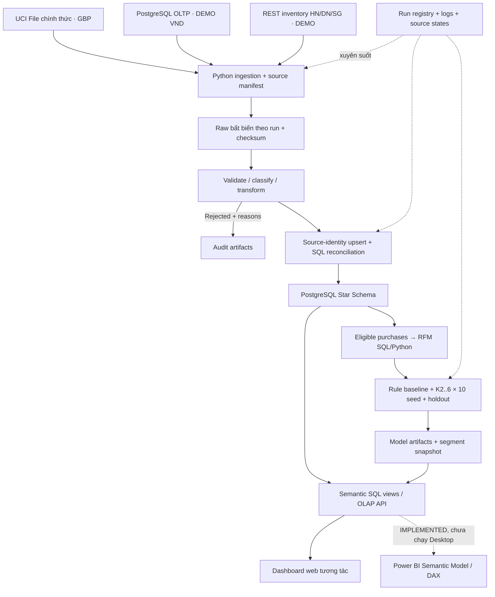

# Kiến trúc RetailPulse đã triển khai

Cập nhật 21/10/2026. Đối chiếu code và các run thực tế trong evidence/. Kiến trúc này thay thế mô tả mở rộng trong README cũ; SYSTEM_CURRENT_STATE_REVIEW.md vẫn là kiểm kê lịch sử ở commit tham chiếu, không bị viết lại thành kết quả chạy.

## Thành phần vận hành

| Tiến trình | Vai trò | Địa chỉ |
|---|---|---|
| Docker retail-oltp-db | Nguồn nghiệp vụ DEMO PostgreSQL | localhost:5432 / retail_app_db |
| Docker retail-dwh-db | Kho phân tích PostgreSQL | localhost:5433 / retail_dwh_db |
| Docker retail-fastapi-app | Ba endpoint inventory trong một ứng dụng | localhost:8001 |
| Python uvicorn src.web.app | Điều phối tác vụ nền, truy vấn DWH, static frontend | localhost:8010 |
| Python ETL/mining | Được CLI hoặc API runner gọi | Run/artifact truy vết trên đĩa và DWH |

Ba endpoint không phải ba server vật lý. Kịch bản dn_outage thay URL DN thành cổng đóng để tạo lỗi kết nối HTTP thật, giữ hai endpoint khác hoạt động; đây là thử nghiệm lỗi nguồn logic, không phải chứng minh phân tán ba máy. OLTP/API có DEMO provenance. Khách/sản phẩm định danh theo source; không tự hợp nhất UCI với App.

## Hợp đồng dữ liệu

- Sales grain: một dòng nguồn, key ổn định file(checksum/sheet/row) hoặc order_items.id, scoped theo source. Hash nội dung chỉ dùng so sánh thay đổi.
- Inventory grain: một source/branch/product tại timestamp snapshot gốc. Source status nằm riêng; offline không tạo SKU ALL_PRODUCTS hoặc tồn 0.
- Segment grain: khách trong một model version/lần phân tích; có window, source, currency, run_id. Xem đúng một run trên BI.
- Tiền NUMERIC(20,4), GBP/VND tách biệt. PURCHASE dương; RETURN âm; CANCELLATION đứng riêng. UCI mã C/âm là return proxy theo hợp đồng.
- Raw có checksum, manifest, thời điểm thu thập; loader lưu raw_path/source_record_id. Replay kiểm checksum trước xử lý, giữ collection time cũ để không giả vờ API mới cập nhật.
- Mỗi batch/source có inserted, updated, unchanged, rejected, failed và SQL đối soát cùng tập khóa. Chạy lại đã kiểm chứng trên toàn bộ UCI, không chỉ fixture nhỏ.

## Thực thi thật và UI

POST /api/runs trả run_id; worker nền gọi pipeline thật, giới hạn một tác vụ trong tiến trình web. Poll trạng thái PENDING/RUNNING/SUCCESS/PARTIAL/FAILED, đọc logs/reconciliation/artifacts. Không có timeout tự báo SUCCESS hoặc metric random trong các trang chính. UI cũ được lưu ở frontend/demo với nhãn DEMO.

Run registry JSON ghi atomic tại data_lake/runs/<run_id>/run.json, mirror PostgreSQL khi kết nối được. Registry hiển thị lỗi thật. Đây là runner cục bộ phục vụ đồ án, không có distributed durable queue/resume sau process crash. Không triển khai Airflow, Debezium, Kafka thật, MinIO, VPN trong luồng chính; local Raw đáp ứng phạm vi hiện tại.

## Phân tích

SQL views tách signed amounts, source-aware orders, snapshot mới nhất, model run. Web hỗ trợ roll-up/drill-down/slice/dice/pivot/drill-through và lineage. RFM dùng calendar window chính xác, PURCHASE hợp lệ, bỏ GUEST, log1p + StandardScaler; EDA giữ ngoại lệ và ghi rõ. Chọn K qua nhiều seed và guard kích thước/ARI; holdout không tham gia chọn K.

Xem [Data Dictionary](DATA_DICTIONARY.md), [Lineage](DATA_LINEAGE.md), [KPI](KPI_DEFINITIONS.md), [Protocol](MINING_EXPERIMENT_PROTOCOL.md), [Kết quả thật](EXPERIMENT_RESULTS.md), [Giới hạn](SYSTEM_LIMITATIONS.md).

S? ?? c?p nh?t: [HLD v4 draw.io](architecture/RetailPulse_HLD_v4.drawio), [SVG](architecture/RetailPulse_HLD_v4.svg). V3 v? s? ?? ban ??u v?n gi? nguy?n ?? ??i chi?u.
